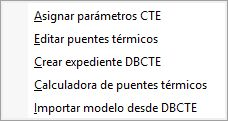
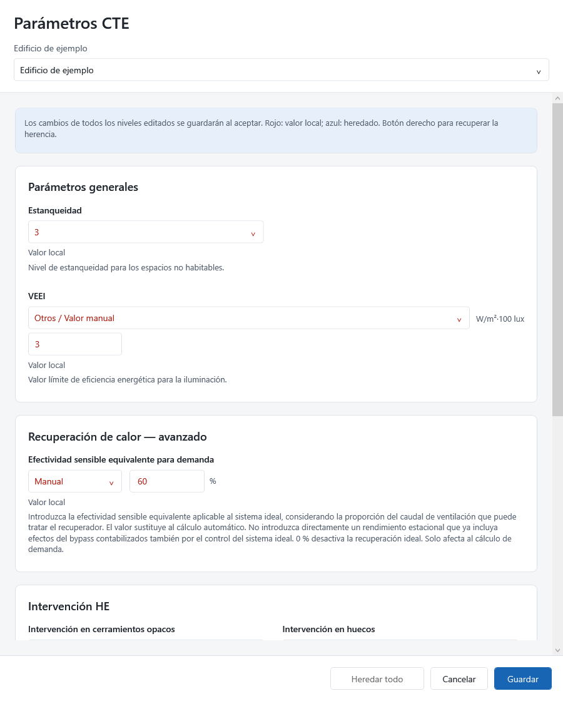
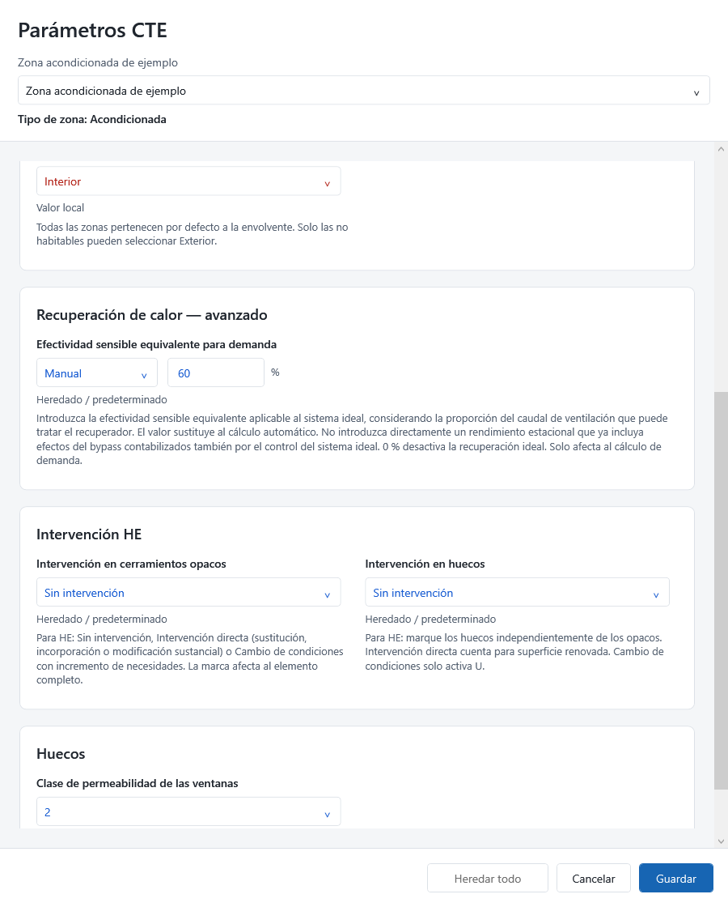
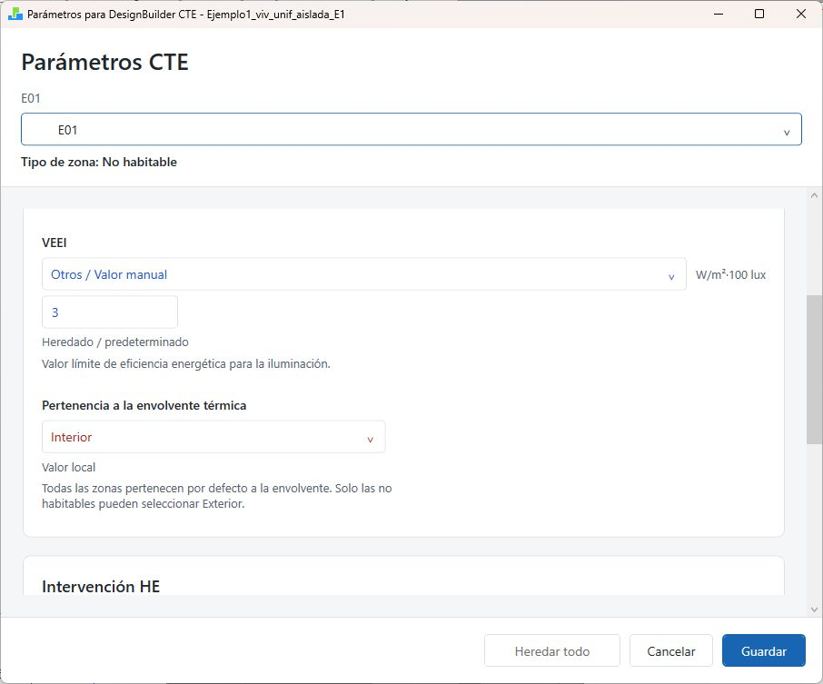
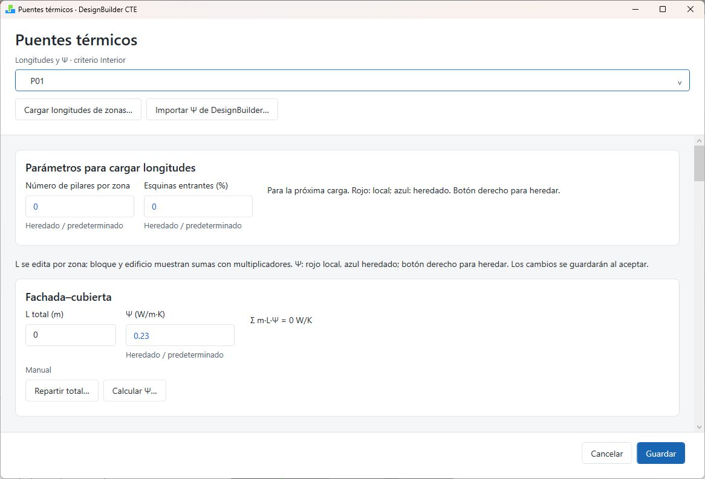
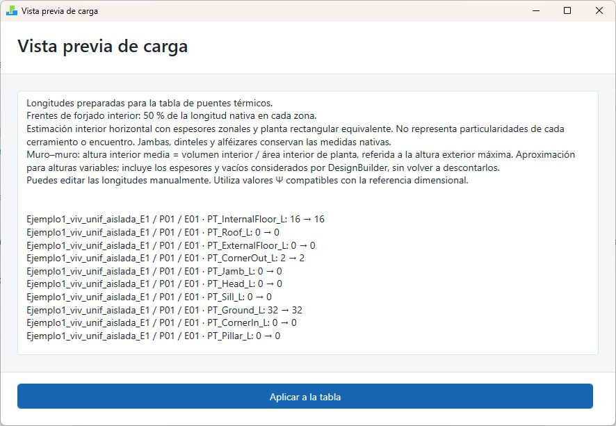
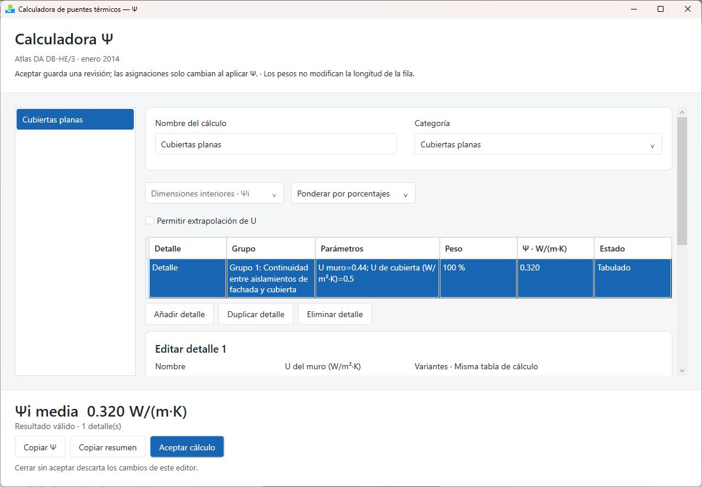
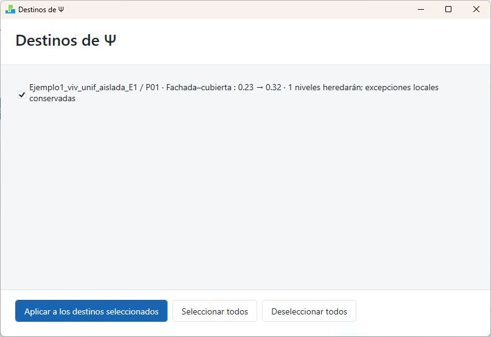

# Plugin y exportación del expediente {#sec-plugin}

Con el modelo preparado, utilice el plugin para asignar parámetros CTE, revisar puentes térmicos y crear el expediente `.dbcte`. Trabaje desde los valores comunes del edificio hacia las excepciones. Las capturas muestran una vivienda de ejemplo; sus valores no son valores recomendados para otros proyectos.

## Menú del plugin {#sec-menu-plugin}

Con el modelo cargado, abra **DesignBuilder CTE** en la barra superior.

{width=40% fig-alt="Menú del plugin con el modelo cargado."}

| Comando | Para qué sirve |
|---|---|
| Asignar parámetros CTE | Completar parámetros del edificio y excepciones por niveles |
| Editar puentes térmicos | Revisar las longitudes, Ψ y aportaciones de los encuentros |
| Crear expediente DBCTE | Elegir el destino y preparar la siguiente exportación IDF |
| Cancelar creación del expediente | Retirar la solicitud de creación pendiente |
| Calculadora de puentes térmicos | Organizar cálculos Ψ del edificio y asignarlos a encuentros |
| Importar modelo desde DBCTE | Recuperar en DesignBuilder el modelo incluido en un expediente |

**Crear expediente DBCTE** y **Cancelar creación del expediente** aparecen en estados alternativos. Elegir un destino prepara la solicitud; el expediente se completa después de la exportación IDF.

La carga de longitudes está dentro de **Editar puentes térmicos**, mediante **Cargar longitudes de zonas…**.

## Aspecto y manejo de las ventanas {#sec-interfaz-plugin}

La cabecera y el selector identifican el edificio, bloque o zona que está editando. Compruebe el destino antes de cambiar un dato. Amplíe la ventana o desplácese para acceder a las entradas inferiores y a sus ayudas.

Los colores indican el origen del valor:

- **Azul — Heredado / predeterminado:** se utiliza el valor de un nivel superior o el valor inicial del parámetro.
- **Rojo — Valor local:** el valor está fijado en ese objeto y sustituye al heredado.

Para un valor común a varias zonas, edite el edificio o bloque que comparten. Los objetos que lo heredan recibirán el cambio; los que tienen un valor local mantendrán su excepción.

Distinga las acciones de guardado:

| Acción | Qué conserva |
|---|---|
| Aceptar cálculo / Aplicar | Prepara un cálculo o una asignación dentro del editor que lo contiene |
| Guardar / Guardar en el modelo | Acepta los cambios del plugin en el modelo abierto |
| Guardar DSB en DesignBuilder | Conserva el modelo en disco |

Complete las acciones del editor principal después de cerrar una ventana auxiliar. Por ejemplo, aplicar un reparto de longitudes a la tabla todavía requiere **Guardar** en el editor de puentes y guardar el DSB.

## Seleccionar el ámbito y asignar parámetros {#seleccionar-el-ámbito}

1. Seleccione el edificio y abra **Asignar parámetros CTE**.
2. Compruebe el destino indicado en la cabecera.
3. Introduzca los valores comunes en el nivel más alto que los comparta.
4. Utilice el selector para recorrer edificio, bloques y zonas.
5. Para una excepción en una superficie o hueco, seleccione primero ese elemento en DesignBuilder y después abra el editor.
6. Revise los mensajes de validación y pulse **Guardar**.
7. Guarde también el DSB.

El editor muestra únicamente los campos disponibles en el nivel seleccionado. Que un campo no aparezca en un hueco no significa que se haya borrado del edificio.

Las superficies y huecos se identifican mediante el título y los datos disponibles del objeto, como tipo, área, orientación o condición interior/exterior. Dos elementos con el mismo nombre siguen siendo independientes: compruebe su zona y superficie de origen.

{width=90% fig-alt="Parámetros del edificio: estanqueidad y selección de VEEI."}

## Valor local, heredado y efectivo

El **valor efectivo** es el que resulta después de resolver la herencia. Para retirar una excepción, pulse con el botón derecho sobre su campo y elija **Heredar del nivel superior**: pasará de rojo a azul. Cambiar un campo no convierte los demás en locales.

**Heredar todo** retira las excepciones heredables del objeto. Revise antes qué datos desea conservar. **Guardar** acepta los cambios y **Cancelar** los descarta.

## Diccionario de parámetros

Los datos generales se editan en **Asignar parámetros CTE**. Los campos de pilares, esquinas, longitudes y Ψ se revisan en **Editar puentes térmicos**.

| Campo | Ámbito | Unidad o valor inicial | Finalidad |
|---|---|---|---|
| Estanqueidad | Edificio, bloque y zona | Nivel 1 a 5; inicial 3 | Caracterizar espacios no habitables |
| Efectividad sensible equivalente para demanda | Edificio, bloque y zona acondicionada | Automático; Manual 0–100 % | Sustituir la efectividad final del recuperador ideal |
| VEEI | Edificio, bloque y zona | W/m²·100 lux; valor manual inicial 3 | Límite de eficiencia de iluminación del uso terciario |
| Pertenencia a la envolvente térmica | Zona | Interior | Incluir la zona en la envolvente; Exterior solo para no habitables |
| Intervención en cerramientos opacos | Edificio, bloque, zona y superficie | Sin intervención | Identificar los opacos afectados por la actuación HE |
| Intervención en huecos | Edificio, bloque, zona, superficie y hueco | Sin intervención | Marcar los huecos independientemente de los opacos |
| Clase de permeabilidad de las ventanas | Edificio, bloque, zona, superficie y hueco | Clase 1 a 4; inicial 2 | Caracterizar la permeabilidad de los huecos |
| Aislamiento perimetral (D) | Edificio | m; inicial 0 | Dimensión característica del aislamiento perimetral de solera |
| Aislamiento perimetral (Ra) | Edificio | m²K/W; inicial 0 | Resistencia térmica del aislamiento perimetral |

Los valores iniciales facilitan la entrada; no acreditan las características del edificio. Revise las unidades, el ámbito y los mensajes mostrados antes de guardar.

### Estanqueidad

**Estanqueidad** caracteriza los espacios no habitables. Defina el nivel común en edificio o bloque y revise las excepciones por zona. No equivale al n50 ni a la clase de permeabilidad de una ventana.

### Iluminación: seleccionar VEEI

Abra la lista de usos y seleccione la descripción que corresponda al espacio. Para un límite específico, elija **Otros / Valor manual** e introduzca el número en la entrada inferior. Revise ambos controles: la lista identifica el criterio y el número expresa el límite utilizado.

VEEI se utiliza en los espacios terciarios y no equivale a la potencia de iluminación instalada. Compruebe el uso, la iluminancia y las excepciones de cada zona.

### Recuperación de calor para demanda {#sec-recuperacion-demanda-plugin}

La recuperación de calor reduce la demanda de calefacción o refrigeración aprovechando el aire extraído para acondicionar el aire exterior. Para calcular esa demanda, DesignBuilder CTE representa su efecto mediante un porcentaje de **efectividad sensible equivalente** en el sistema ideal de cada zona. Este ajuste no modifica el recuperador del modelo utilizado para calcular el consumo.

El campo está en **Asignar parámetros CTE > Recuperación de calor — avanzado**. Puede elegir:

| Modo | Qué valor utiliza el cálculo de demanda |
|---|---|
| **Automático** — predeterminado | Lo calcula a partir de los datos del recuperador y del caudal de ventilación atendido. |
| **Manual** | Utiliza directamente el porcentaje que introduzca, entre **0 y 100 %**, incluidos decimales. **0 % desactiva la recuperación en demanda para esa zona**. |

#### Cómo se obtiene el valor automático

El programa toma el menor de los cuatro rendimientos sensibles del recuperador: calefacción y refrigeración al 75 % y al 100 % del **caudal de aire**. Si el caudal nominal del recuperador es inferior a la ventilación total de las zonas atendidas, reduce ese rendimiento en la misma proporción.

**Ejemplo:** el menor rendimiento es 73 %, el recuperador trata 600 m³/h y las zonas necesitan 1.000 m³/h. La efectividad equivalente es **73 % × 600 / 1.000 = 43,8 %**. Si el recuperador cubre todo el caudal, se utiliza el 73 %. Con caudal nominal **Autosize**, se supone cobertura completa, sin realizar un dimensionado previo.

#### Cuándo utilizar Manual

Mantenga Automático salvo que disponga de una justificación técnica para otro valor equivalente. Un **Manual de 60 %** sustituye al 43,8 % del ejemplo: el programa aplica el 60 % sin volver a reducirlo por caudal. Por tanto, el porcentaje introducido debe considerar ya cuánto aire puede tratar el recuperador.

No introduzca directamente un rendimiento estacional que incluya el efecto del bypass: el control del sistema ideal puede contabilizarlo de nuevo. Conserve la justificación del valor elegido.

#### Cómo configurarlo y heredarlo

Defina el ajuste común en **edificio** o **bloque**. Las zonas lo heredan y cada **zona acondicionada** puede tener una excepción, aunque comparta recuperador con otras zonas. Modo y porcentaje se heredan juntos.

- Para fijar otro porcentaje, seleccione **Manual** e introdúzcalo.
- Para usar el cálculo automático bajo un edificio o bloque con Manual, seleccione **Automático** en la zona.
- Para eliminar la excepción, pulse con el botón derecho y elija **Heredar del nivel superior**.

{width=90% fig-alt="Zona acondicionada con recuperación manual del 60 por ciento heredada del edificio."}

Pulse **Guardar**, guarde el modelo DSB y exporte el expediente. Ábralo en DesignBuilder CTE y pulse **Calcular**. El registro muestra la efectividad aplicada a cada zona.

#### Alcance del ajuste

Solo se aplica a zonas acondicionadas con ventilación exterior atendida por un recuperador. No crea recuperación donde no existe ni activa un equipo permanentemente parado. Una excepción manual no cambia la ventilación ni la efectividad automática de las demás zonas: sus caudales siguen formando parte del total atendido.

La equivalencia considera únicamente el calor sensible, no el intercambio de humedad. Es una aproximación: no reproduce en detalle los horarios propios del recuperador, el desescarche ni todos sus controles. Tomar el menor rendimiento no garantiza por sí solo una demanda anual más desfavorable.

### Huecos y aislamiento perimetral

Seleccione la **Clase de permeabilidad de las ventanas** conforme a la documentación de las carpinterías. Establezca una clase común y las excepciones en los huecos que sean distintos.

Para el aislamiento perimetral de solera, introduzca `D` y `Ra` en el edificio; cero cuando no existe. DesignBuilder CTE los utiliza según el caso de solera y el aislamiento de sus capas. Consulte [Cerramientos en contacto con el terreno](04-preparar-designbuilder.qmd#cerramientos-en-contacto-con-el-terreno).

## Indicador informativo del tipo de zona {#sec-indicador-zona}

Al seleccionar una zona, la cabecera muestra **Tipo de zona: Acondicionada**, **No acondicionada** o **No habitable**. Es información de solo lectura, determinada por el grupo HVAC y por la casilla **Ocupada** de **Actividad**, según [Clasificación de las zonas](04-preparar-designbuilder.qmd#sec-clasificacion-zonas).

1. Seleccione la zona y lea su tipo.
2. Compruebe **Pertenencia a la envolvente térmica**.
3. Si el tipo es incorrecto, cierre el editor y revise el grupo HVAC o la casilla **Ocupada** en DesignBuilder.
4. Abra otra vez el editor y compruebe el resultado.
5. Guarde si ha modificado parámetros.

Las zonas acondicionadas y no acondicionadas son habitables y deben permanecer en **Interior**. **Exterior** requiere una zona no habitable y una exclusión justificada. Una zona no habitable también puede permanecer en Interior. Consulte [Espacios habitables y envolvente térmica](04-preparar-designbuilder.qmd#sec-envolvente-zonas) para sus efectos sobre superficies y volumen.

{width=90% fig-alt="Zona E01: No habitable e Interior; VEEI se muestra heredado."}

## Parámetros que se completan en la aplicación {#n50-opcional-para-infiltraciones}

**n50 adoptado** se introduce en **Datos del Edificio > Características** de DesignBuilder CTE. **Usar valor de reflectancia de los materiales** se configura en **Datos del modelo**. Ambos pertenecen al expediente y deben revisarse al crear uno nuevo; no se introducen en el plugin. Consulte [n50 adoptado](06-aplicacion.qmd#sec-n50-adoptado) y [Reflectancia de los materiales](06-aplicacion.qmd#sec-reflectancia).

Al guardar parámetros, el plugin conserva los atributos vigentes y retira los que ya no reconoce. Cancelar mantiene el modelo sin cambios.

## Marcas de intervención HE

Los campos de opacos y huecos se editan por separado en **Asignar parámetros CTE**.

| Marca | Cuándo corresponde |
|---|---|
| Sin intervención | El elemento no se interviene |
| Intervención directa | Se sustituye, incorpora o modifica sustancialmente; cuenta como superficie renovada |
| Cambio de condiciones | Cambian las condiciones y aumenta la demanda; no equivale a sustitución ni suma como renovación directa |

1. Defina el criterio común en el nivel adecuado.
2. Marque las excepciones en superficies y huecos.
3. Revise opacos y huecos por separado: intervenir una fachada no implica sustituir sus ventanas.
4. Guarde y exporte de nuevo.
5. Complete también **Datos del Edificio > Ámbito HE** en DesignBuilder CTE.

Las marcas describen la actuación; no cambian por sí mismas materiales, instalaciones o propiedades físicas. Los elementos sin valor local utilizan el heredado o **Sin intervención**. Revise las excepciones y el alcance del modelo antes de generar la documentación HE.

## Puentes térmicos {#sec-puentes-termicos}

Abra **Editar puentes térmicos**. La cabecera muestra el criterio dimensional **Interior** o **Exterior**. Seleccione edificio, bloque o zona y revise cada tarjeta: longitud L, transmitancia lineal Ψ, origen y aportación.

- En zona, **L (m)** se edita por instancia.
- En bloque y edificio, **L total (m)** es la suma con multiplicadores. No repita ese total en cada zona.
- La aportación es **L × Ψ**, en W/K. Revise ambas magnitudes y el signo de Ψ.

Utilice longitudes y Ψ definidos con el mismo criterio dimensional. En el expediente actual se exporta la tabla completa; DesignBuilder CTE utiliza esas longitudes y valores Ψ. Si la tabla es inválida, corríjala en el plugin y vuelva a exportar.

{width=100% fig-alt="Editor de puentes del bloque P01: longitud total, Ψ heredado y acciones del encuentro."}

### Tipos de encuentro

La tabla contiene trece tipos:

| Encuentro | Qué revisar |
|---|---|
| Fachada-cubierta | Encuentro superior de la envolvente |
| Fachada-balcón | Vuelo y continuidad del aislamiento |
| Esquina saliente | Encuentros exteriores salientes |
| Esquina entrante | Concavidades, signo y criterio dimensional |
| Fachada-forjado interior | Frente del forjado intermedio |
| Partición interior-fachada/cubierta | Encuentros de particiones con la envolvente |
| Fachada-solera/terreno | Encuentro inferior con terreno |
| Pilar-fachada/cubierta | Pilares de envolvente, sin duplicación |
| Jambas | Laterales de huecos |
| Dinteles/capialzados | Parte superior de huecos y cajones compatibles |
| Alféizares | Parte inferior de huecos |
| Fachada-suelo exterior | Suelos expuestos al exterior |
| Otros encuentros | Encuentros que requieren caracterización específica |

Balcón, partición y otros no tienen equivalencia automática con el atlas en este editor. Introduzca un Ψ justificado externamente para esos casos. Los Ψ negativos pueden ser correctos; conserve su signo cuando corresponda a la solución y al criterio dimensional.

Si el editor avisa de que adaptará datos antiguos al guardar, revise los valores antes de aceptarlos. Esa adaptación conserva los valores efectivos previos; la nueva estimación de longitudes se realiza cuando solicita expresamente la carga.

### Cargar longitudes de zonas

1. Seleccione el ámbito que desea cargar.
2. Revise **Número de pilares por zona** y **Esquinas entrantes (%)**. Preparan la siguiente carga y no representan longitudes.
3. Pulse **Cargar longitudes de zonas…**.
4. Lea la vista previa: objeto, valor anterior y propuesto.
5. Revise los avisos y las zonas afectadas.
6. Pulse **Aplicar a la tabla** si la propuesta corresponde al modelo.
7. Revise las tarjetas y pulse **Guardar**.

El número de pilares y el porcentaje de esquinas parten de cero y pueden heredarse. Los pilares se estiman con el número indicado y la altura derivada de la zona; si esa altura no puede estimarse, el aviso indica que se mantiene la longitud anterior. Las esquinas se reparten según el porcentaje entrante.

{width=100% fig-alt="Vista previa de carga con avisos y longitudes anteriores y propuestas por zona."}

La vista previa explica las aproximaciones utilizadas. En el ejemplo, los frentes de forjado interior toman el 50 % de la longitud nativa de cada zona. La estimación interior horizontal utiliza espesores zonales y una planta rectangular equivalente. Jambas, dinteles y alféizares conservan las medidas nativas. Para muro-muro utiliza una altura interior media derivada de volumen/área, referida a la altura exterior máxima. Revise las singularidades del edificio antes de aplicar.

Cerrar la vista previa sin aplicar conserva la tabla anterior. **Cancelar** en el editor principal descarta los cambios preparados; **Guardar** los acepta.

### Importar Ψ de DesignBuilder

1. Seleccione el nivel de destino.
2. Pulse **Importar Ψ de DesignBuilder…**.
3. Compare los valores anteriores y propuestos.
4. Aplique a la tabla y revise el origen local de los campos.
5. Guarde.

Se sustituyen los Ψ compatibles del nivel seleccionado y se conservan los restantes. Esta operación no carga longitudes. Compruebe que cada valor importado representa la solución constructiva prevista.

### Repartir una longitud total

1. Seleccione edificio o bloque.
2. Pulse **Repartir total…** en el encuentro elegido.
3. Introduzca el total que quiere distribuir, incluidas las repeticiones de zona.
4. Elija **Longitud previa** o **Superficie** como criterio.
5. Pulse **Vista previa**.
6. Revise pesos, multiplicadores, longitudes por instancia y total resultante.
7. Pulse **Aplicar a la tabla** y después **Guardar**.

{width=90% fig-alt="Reparto de una longitud total: criterio y vista previa antes de aplicar."}

Cambiar el total o el criterio invalida la vista previa: calcúlela otra vez. El reparto de longitud no modifica Ψ.

### Recuperar la herencia en puentes

Pulse con el botón derecho sobre Ψ, el número de pilares o el porcentaje de esquinas:

- **Heredar del nivel superior:** retira la excepción del objeto seleccionado.
- **Heredar hasta nivel de bloque:** retira las excepciones hasta los bloques afectados.
- **Heredar hasta nivel de zona:** alcanza también las zonas de esa rama.

Desde edificio se conserva su valor y se retiran las excepciones inferiores del parámetro. Desde bloque se recupera primero el valor superior. Estas acciones no heredan las longitudes de zona.

### Revisar y guardar

Compruebe las trece categorías y los encuentros que no hayan recibido una longitud durante la carga. Cambie a zona para corregir L cuando sea necesario. Guarde el editor y el DSB. Después de modificar puentes, vuelva a exportar y calcular antes de generar los documentos.

En terciario, el edificio de referencia conserva las longitudes y aplica sus Ψ de referencia. Para balcón, partición y otros se utiliza Ψ = 0 únicamente en la referencia; el edificio objeto conserva los valores introducidos.

## Calculadora de puentes térmicos

Abra **Calculadora de puentes térmicos** desde el menú para organizar los cálculos Ψ del edificio. También puede entrar desde **Calcular Ψ…** o **Editar cálculo…** de un encuentro de la tabla de puentes.

### Organizar el conjunto de cálculos

| Acción | Resultado |
|---|---|
| Añadir cálculo | Abre un cálculo nuevo |
| Editar… | Prepara una nueva revisión del cálculo seleccionado |
| Duplicar | Crea una copia independiente para otra solución |
| Eliminar | Retira un cálculo sin asignaciones activas, previa confirmación |
| Importar .ctepsi… | Añade cálculos del archivo, sin asignarlos a encuentros |
| Exportar selección… | Guarda los cálculos seleccionados como archivo reutilizable |
| Exportar todo… | Guarda el conjunto completo como archivo reutilizable |
| Asignar Ψ… | Permite elegir destinos compatibles |
| Guardar en el modelo | Conserva el conjunto y las asignaciones en el modelo abierto |
| Cancelar | Descarta lo preparado en esta ventana |

Un archivo `.ctepsi` permite reutilizar cálculos; no sustituye al DSB ni crea un expediente DBCTE. Al importarlo, revise el criterio dimensional del modelo receptor antes de asignar sus cálculos.

### Crear un cálculo paso a paso

1. Pulse **Añadir cálculo** y escriba un nombre que identifique la solución.
2. Seleccione la **Categoría** del encuentro.
3. Compruebe **Dimensiones interiores Ψi** o **exteriores Ψe**; el criterio queda fijado cuando procede del modelo.
4. Elija ponderación **por porcentajes** o **por longitudes**.
5. Seleccione el grupo y el detalle constructivo del atlas.
6. Introduzca U del muro y el parámetro adicional solicitado, con sus unidades.
7. Complete el peso del detalle y revise el resultado y sus condiciones de aplicación.
8. Pulse **Aceptar cálculo**.

{width=100% fig-alt="Calculadora Ψ: categoría, ponderación, datos de entrada y resultado."}

El ejemplo muestra una cubierta plana del grupo 1, detalle 01, con criterio interior, U del muro = 0,44 W/m²K, U de cubierta = 0,50 W/m²K y un detalle al 100 %. El resultado es Ψi = 0,320 W/(m·K), **Tabulado**. Es una demostración del manejo del atlas; debe comprobar si la solución representa su encuentro real.

### Combinar detalles y revisar opciones

**Añadir detalle** incorpora otra solución de la misma categoría; **Duplicar detalle** copia la seleccionada; **Eliminar detalle** la retira. Revise los pesos después de cada operación. Cambiar de categoría sustituye los detalles del cálculo y requiere confirmación.

- **Por porcentajes:** distribuya la participación de las soluciones.
- **Por longitudes:** introduzca la longitud representada por cada solución. Al convertir porcentajes a longitudes, se solicita el total para transformar los pesos.

Los pesos obtienen el Ψ medio y no sustituyen la longitud L de la tabla de puentes. Por ejemplo, Ψ de 0,30 y 0,50 ponderados al 60 % y 40 % dan 0,38 W/(m·K); es un ejemplo aritmético.

Las miniaturas seleccionan variantes del atlas. **Ampliar detalle seleccionado** abre el dibujo; revise **Condiciones de aplicación y notas del atlas**. **Permitir extrapolación de U** autoriza extrapolar U, no dimensiones geométricas. **Desglose y trazabilidad del cálculo** explica cómo se obtuvo el resultado. **Copiar Ψ** copia el número y **Copiar resumen** la explicación del cálculo.

### Asignar Ψ a los encuentros

1. Seleccione un cálculo del conjunto.
2. Pulse **Asignar Ψ…**.
3. Revise cada destino: objeto, tipo de encuentro, valor anterior, nuevo valor y niveles que heredarán el cambio.
4. Marque los destinos que compartan la solución; **Seleccionar todos** y **Deseleccionar todos** permiten rehacer la selección.
5. Pulse **Aplicar a los destinos seleccionados**.
6. Revise las asignaciones y pulse **Guardar en el modelo**.
7. Guarde el DSB.

{width=90% fig-alt="Destinos de Ψ: encuentro, valor anterior, valor nuevo y herencia prevista."}

Desde una fila de puentes, la acción se denomina **Aplicar al encuentro** y restringe el destino al contexto seleccionado. En ese caso, pulse después **Aceptar conjunto**, complete **Guardar** en el editor de puentes y guarde el DSB. Aplicar Ψ no modifica L; las excepciones locales inferiores se conservan salvo que actúe sobre ellas.

### Modificar un cálculo ya utilizado

Editar y aceptar un cálculo crea una revisión; no actualiza automáticamente sus asignaciones. Si aparece **Hay una revisión más reciente**, revise el cálculo y asigne la revisión nueva a los destinos que deban cambiar. Guarde y vuelva a exportar.

Para eliminar un cálculo con asignaciones activas, sustituya primero esas asignaciones. Revise el panel de destinos para conocer dónde se utiliza.

## Crear un expediente DBCTE

### Preparar el modelo

1. Guarde el DSB y seleccione el edificio correcto.
2. Compruebe las [Opciones obligatorias](04-preparar-designbuilder.qmd#sec-opciones-obligatorias), la clasificación de zonas y su pertenencia a la envolvente.
3. Revise parámetros, longitudes, Ψ y excepciones.
4. En **Opciones del programa > Archivos XML de DesignBuilder**, seleccione **1-Ninguno** para **Incluir datos de bibliotecas en archivo XML de DesignBuilder**.
5. Prepare una carpeta de salida con permiso de escritura.

Si la inclusión de bibliotecas sigue activada o no puede comprobarse, el plugin informa del problema y no prepara el expediente. Corrija la opción y repita la solicitud.

### Crear y comprobar

1. Abra **DesignBuilder CTE > Crear expediente DBCTE**.
2. Elija el nombre y destino del `.dbcte`.
3. Lea el aviso: la siguiente exportación IDF incorporará los datos CTE y el modelo XML.
4. Ejecute la exportación de archivo IDF de EnergyPlus para simulación desde DesignBuilder.
5. Corrija los avisos que impidan continuar.
6. Espere la confirmación de creación correcta.
7. Abra el `.dbcte` en DesignBuilder CTE y compruebe el edificio y su estado.

El nombre elegido prepara el destino; compruebe la confirmación de creación y la apertura del archivo al terminar la exportación. Si se cancela o falla la exportación, repita el procedimiento.

Después de exportar, puede abrir el `.dbcte` con doble clic desde el Explorador. DesignBuilder CTE utiliza una sola ventana y permite guardar, descartar o cancelar antes de cambiar de proyecto. Consulte [Abrir desde Windows](06-aplicacion.qmd#abrir-desde-windows).

Para identificar una cámara sanitaria y declarar su profundidad o una U justificada, consulte [Cámaras sanitarias en la guía del plugin](https://ayudacte.ecoeficiente.es/plugin/capitulos/01-parametros.html#sec-camaras-sanitarias).

### Cancelar una creación pendiente

Tras elegir destino, el menú ofrece **Cancelar creación del expediente**. Utilícelo para retirar la solicitud y evitar que la siguiente exportación complete ese destino. Después puede volver a iniciar **Crear expediente DBCTE**.

Cancelar la solicitud no borra un expediente que ya se haya creado.

## Importar modelo desde DBCTE

Esta operación recupera el XML del modelo incluido en el expediente y lo abre en DesignBuilder como un modelo nuevo.

1. Guarde el trabajo actual antes de importar.
2. Seleccione **DesignBuilder CTE > Importar modelo desde DBCTE**.
3. Elija el expediente y lea la confirmación.
4. Confirme la creación del modelo si es el archivo previsto.
5. Guarde el nuevo DSB con otro nombre.
6. Revise cerramientos, bibliotecas, sistemas y parámetros antes de editar.

El expediente de origen se conserva.

Continúe con [Caso práctico: completar una vivienda](06a-ejemplo-guiado.qmd#sec-ejemplo-guiado) o consulte las opciones de [Trabajar con DesignBuilder CTE](06-aplicacion.qmd#sec-aplicacion).
