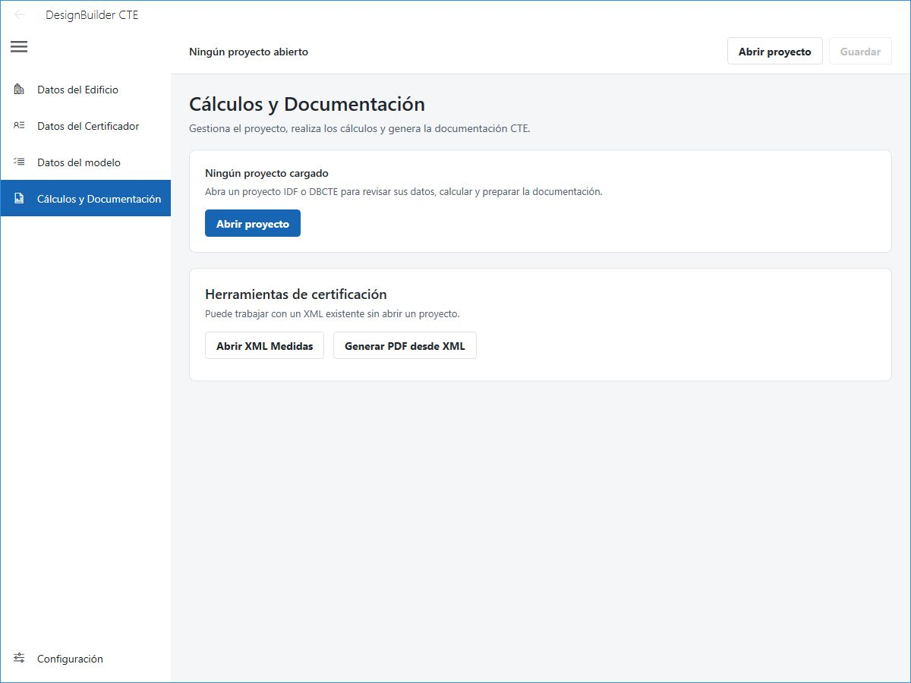
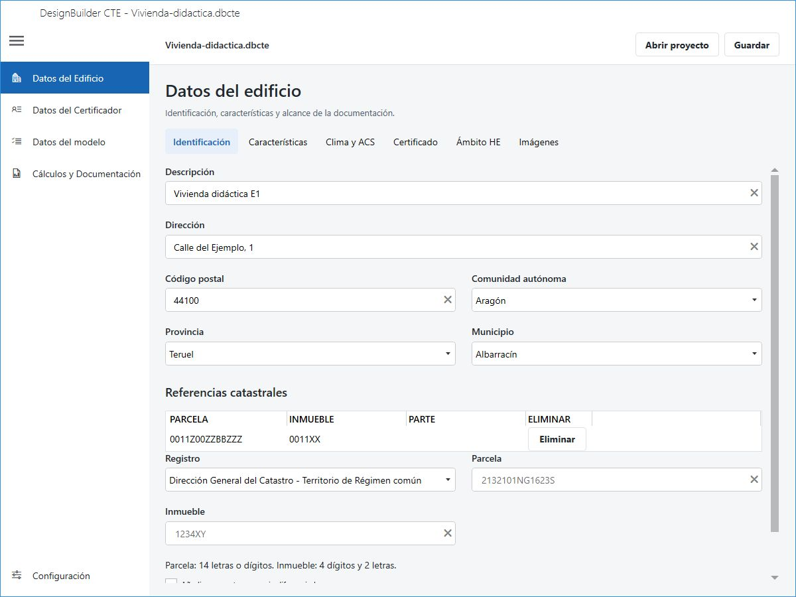
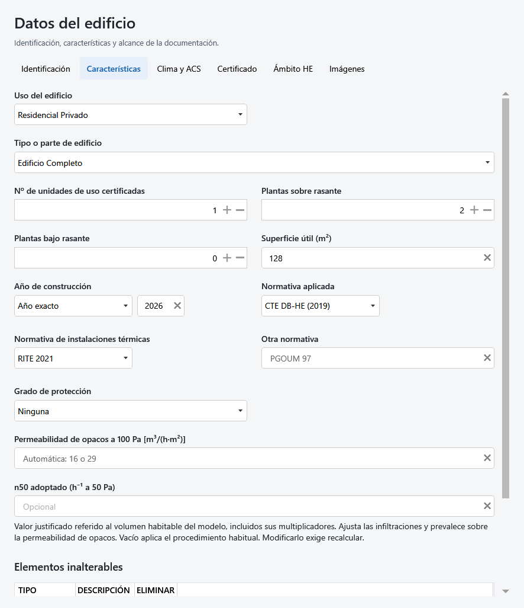
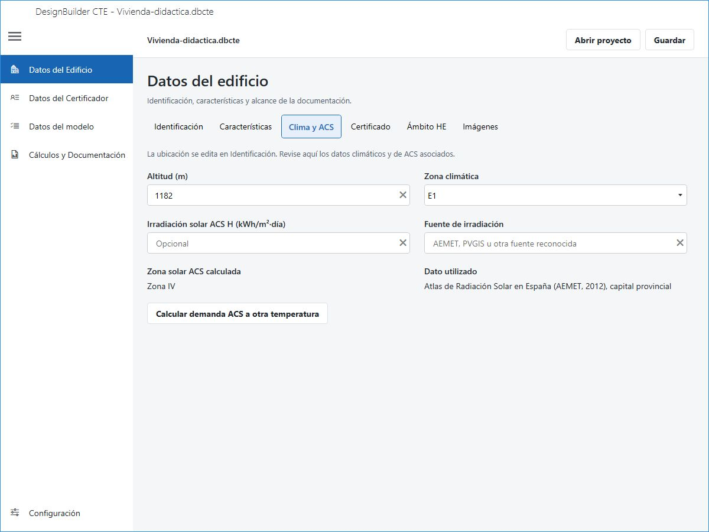
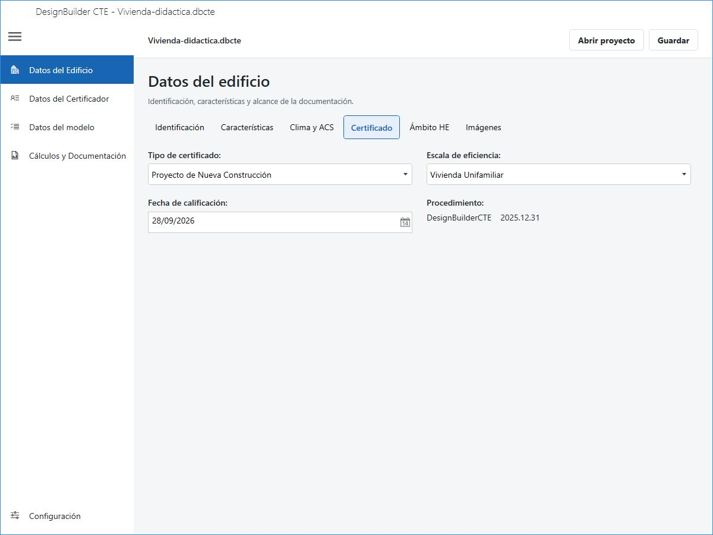
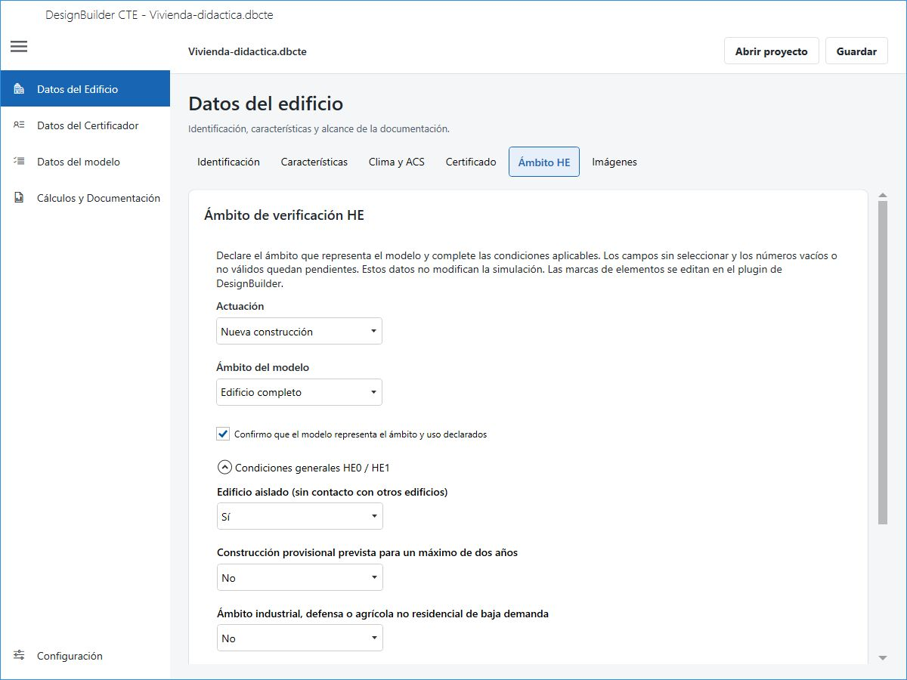
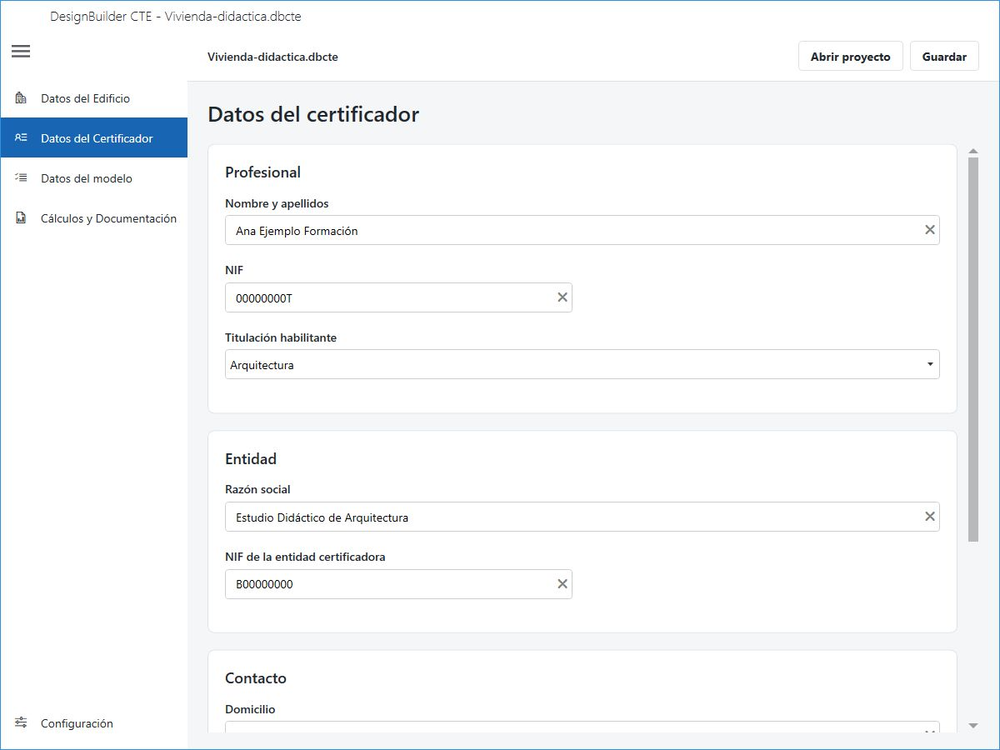
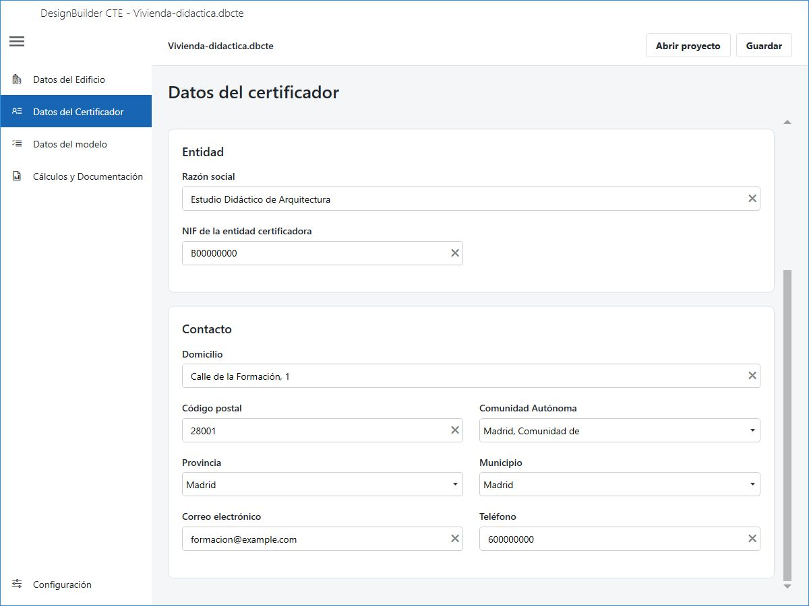
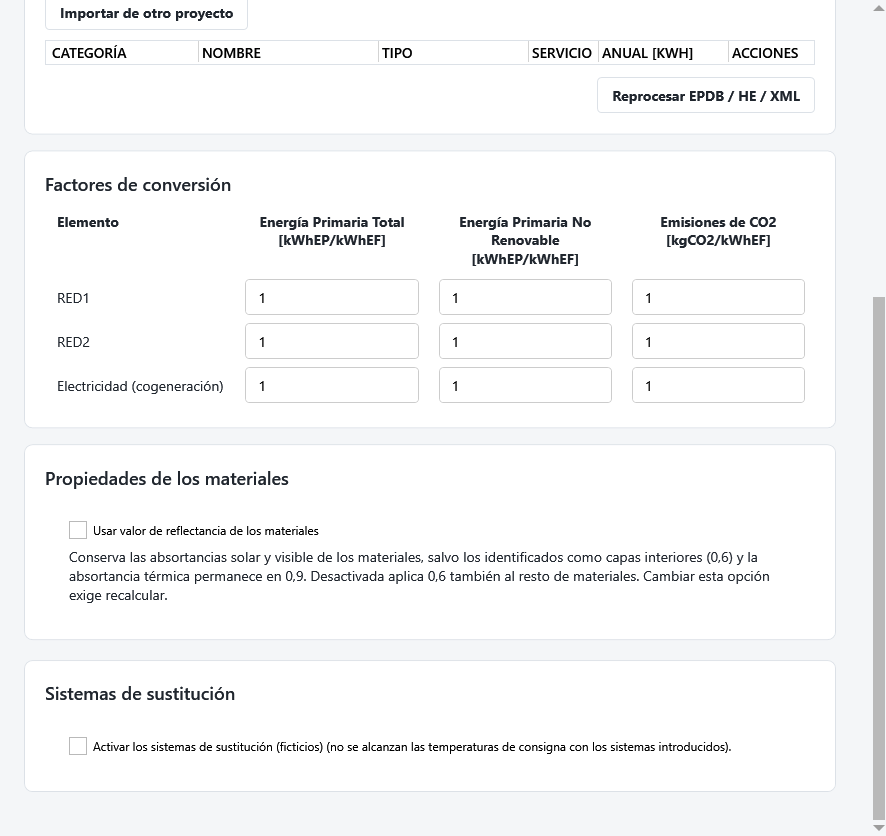
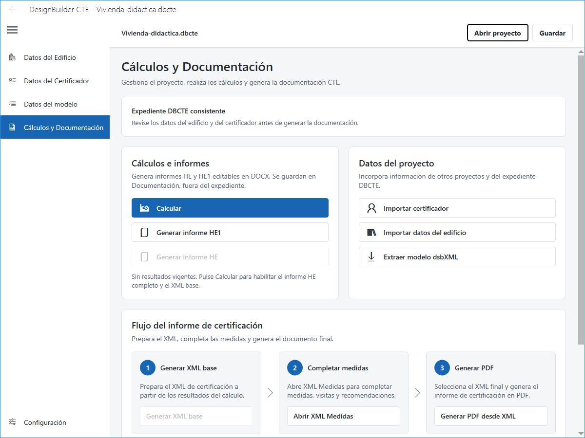

# Caso práctico: completar una vivienda {#sec-ejemplo-guiado}

Este recorrido parte de un expediente `.dbcte` que ya ha generado desde DesignBuilder y explica cómo completar los datos, calcular y obtener el XML final de certificación para un proyecto de vivienda unifamiliar. Las capturas ilustran los formularios y las opciones del procedimiento. Consulte [Trabajar con DesignBuilder CTE](06-aplicacion.qmd#sec-aplicacion) para conocer las opciones de la aplicación; [Cálculo y resultados](07-calculo.qmd#sec-calculo) y [Generar la documentación](08-documentacion.qmd#sec-documentacion) amplían el cálculo y la generación documental.

::: {.callout-note title="Datos ilustrativos"}
Los datos de identificación, dirección, referencia catastral y certificador que aparecen en las capturas son ficticios. Introduzca los datos correspondientes a su proyecto y al profesional que lo certifica. Los valores mostrados sirven para explicar los campos.
:::

## 1. Abrir el expediente del proyecto

Localice el expediente `.dbcte` generado mediante el plugin de DesignBuilder para la vivienda. Guárdelo en la carpeta de trabajo del proyecto, donde se organizarán también los resultados y la documentación. Si todavía no lo ha generado, siga [Plugin y exportación del expediente](05-plugin.qmd#sec-plugin) antes de continuar.

1. Abra DesignBuilder CTE.
2. Pulse **Abrir proyecto**, en la cabecera o en el panel central.
3. Seleccione el expediente `.dbcte` de la vivienda y espere a que termine su carga.
4. Compruebe el nombre en la cabecera y el mensaje de estado del expediente.

{width=100% fig-alt="Pantalla inicial: menú de páginas a la izquierda y apertura del proyecto en la cabecera."}

**Resultado esperado:** el nombre del archivo sustituye a «Ningún proyecto abierto» y se habilita Guardar. «Expediente DBCTE consistente» confirma la consistencia del contenedor, no la corrección técnica de sus datos ni que haya resultados de cálculo.

El menú lateral cambia de página. Las pestañas de Datos del Edificio cambian de sección dentro del mismo formulario. En una ventana estrecha pueden aparecer recogidas en un selector. Cambiar de página conserva la edición en memoria; **Guardar** la conserva en el expediente.

## 2. Identificar el edificio

Entre en **Datos del Edificio > Identificación**. Rellene primero la descripción y la dirección; después seleccione comunidad autónoma, provincia y municipio, en ese orden. Los selectores dependen de la selección anterior.

{width=100% fig-alt="Identificación y referencias catastrales del edificio."}

### Añadir la referencia catastral

1. Seleccione el registro competente; en el ejemplo, Dirección General del Catastro.
2. Escriba la parcela y el inmueble en entradas separadas, siguiendo la ayuda del formulario.
3. Para el edificio principal completo, deje desactivada **Añadir una parte accesoria diferenciada**.
4. Pulse **Añadir Referencia** y compruebe que aparece en la tabla.
5. Para corregir una fila, elimine la referencia equivocada y añada la correcta.

La fila ilustrada utiliza `0011Z00ZZBBZZZ` y `0011XX` como ejemplo ficticio. En un trabajo real, copie la identificación acreditada por Catastro. Los textos grises de las entradas vacías son ejemplos de formato; no son datos ya guardados.

**Comprobación:** una referencia escrita en las entradas pero no añadida a la tabla no debe darse por incorporada. Revise también las filas que ya existieran antes de editar.

## 3. Describir las características

En **Características**, complete el uso, el alcance, las unidades, las plantas, la superficie útil y la antigüedad. Declare la normativa y la protección que correspondan al proyecto. La captura muestra una vivienda completa de dos plantas y 128 m²; no adopte esos valores para otro edificio.

{width=100% fig-alt="Características, superficie útil y normativa del edificio."}

Introduzca los valores de su proyecto. Compruebe la superficie mediante planos y mediciones: el dato del formulario no cambia la geometría del modelo. Las superficies catastrales o energéticas pueden utilizar otra definición y no tienen por qué coincidir con la superficie útil declarada.

Desplácese hasta el final para revisar **Permeabilidad de opacos** y **Elementos inalterables**. Deje la permeabilidad vacía si corresponde utilizar el valor automático; introduzca un valor de proyecto solo con justificación. Añada elementos inalterables únicamente si existe una limitación real, indicando tipo y descripción. «Otra normativa» puede quedar vacía si no procede; el texto gris de ejemplo no debe copiarse automáticamente.

En esta vivienda se deja **n50 adoptado** vacío para utilizar el procedimiento habitual. Si su proyecto dispone de un valor justificado, introdúzcalo en esta sección; al informarlo se deshabilita la permeabilidad de opacos, conservando su valor. Consulte [n50 adoptado](06-aplicacion.qmd#sec-n50-adoptado) para las condiciones de uso.

## 4. Revisar clima y ACS

Abra **Clima y ACS** y compruebe la altitud del emplazamiento y la zona climática correspondiente. La captura muestra **1182 m** y **E1** como ejemplo; los valores de su proyecto deben corresponder a la ubicación de la vivienda.

{width=100% fig-alt="Altitud, zona climática y origen de los datos de irradiación."}

Deje vacíos **Irradiación solar ACS** y **Fuente de irradiación** para utilizar el dato automático mostrado. Si dispone de un dato justificado, introduzca el valor en kWh/m²·día y su fuente conjuntamente. La zona solar ACS y la zona climática E1 son conceptos distintos.

**Calcular demanda ACS a otra temperatura** convierte una demanda diaria conocida a 60 °C al volumen equivalente a la temperatura de impulsión del modelo. Introduzca ambos datos y pulse **Calcular**. La demanda a 60 °C debe calcularse previamente; esta ayuda no la obtiene del número de ocupantes ni modifica automáticamente el modelo de DesignBuilder.

**Resultado esperado:** ubicación, altitud y clima corresponden al mismo emplazamiento, y queda identificado el origen del dato solar utilizado.

## 5. Definir el certificado

En **Certificado**, seleccione **Proyecto de Nueva Construcción** y **Vivienda Unifamiliar** para el proyecto de vivienda unifamiliar de este recorrido. Introduzca la fecha de calificación que corresponda al proyecto.

{width=100% fig-alt="Tipo, escala, fecha y procedimiento del certificado."}

La escala determina la ruta residencial o terciaria. El campo Uso del edificio no la sustituye. El procedimiento se muestra como información de la aplicación: no es el nombre del técnico ni una denominación libre. Compruebe su correspondencia con los documentos generados.

## 6. Declarar el ámbito HE

Abra **Ámbito HE** y seleccione **Nueva construcción** y **Edificio completo** cuando el proyecto comprenda la vivienda completa. Confirme que el modelo representa ese ámbito. Si se trata de una vivienda aislada, seleccione **Sí** en **Edificio aislado**. Esto, por sí solo, no equivale a una exención de las comprobaciones HE.

{width=100% fig-alt="Declaración de nueva construcción y edificio completo; vivienda aislada."}

Responda a las preguntas de condiciones generales según las características del proyecto: construcción provisional, baja demanda y otros supuestos. Seleccione **No** cuando no describan la vivienda. Desplácese por el formulario para revisar las condiciones de ACS y piscinas. Si hay piscinas afectadas, su justificación corre a cargo del usuario y debe añadirse a la memoria justificativa del HE. Si cambia actuación o ámbito, vuelva a comprobar y confirmar la correspondencia del modelo.

La superficie útil total se toma de Datos del Edificio cuando se declara el edificio completo. Si trabaja con una ampliación o parte, complete las superficies específicas que aparezcan. La declaración HE y el tipo de certificado energético tienen funciones distintas y deben ser coherentes entre sí.

## 7. Incorporar imagen y plano

En **Imágenes**, pulse **Cargar imagen del edificio** y seleccione una imagen que permita reconocerlo. Después pulse **Cargar plano del edificio** y seleccione un plano del alcance certificado. Compruebe las dos vistas previas.

Para una vivienda en proyecto, utilice una imagen representativa del edificio proyectado y un plano de la documentación del proyecto. El plano debe permitir reconocer la distribución y el alcance certificado. Revise que cada archivo se haya cargado en el campo correspondiente y que su contenido sea legible.

## 8. Rellenar el certificador

Seleccione **Datos del Certificador**. Complete los grupos Profesional, Entidad y Contacto con la información del técnico que certifica el proyecto. Las capturas muestran datos ficticios.

{width=100% fig-alt="Datos del profesional y de la entidad, ilustrados con valores ficticios."}

1. Introduzca nombre y NIF del profesional.
2. Seleccione la titulación. Si elige Otra, complete la denominación que se solicita.
3. Complete la entidad cuando corresponda al trabajo.
4. Desplácese al grupo Contacto y rellene dirección, ubicación y contactos.
5. Salga de cada campo para comprobar su validación y revise cualquier mensaje mostrado.

{width=100% fig-alt="Datos de contacto ficticios. Desplácese para acceder a los campos inferiores."}

## 9. Revisar errores y guardar

Si aparece **Revisar campos**, despliegue la lista y seleccione un error para ir a la entrada correspondiente. Revise también las secciones no visibles.

Pulse **Guardar** y, cuando se solicite el destino, seleccione el expediente `.dbcte` del proyecto. Compruebe el nombre que queda en la cabecera. La edición queda guardada; puede continuar con los parámetros del modelo.

## 10. Revisar datos del modelo

Entre en **Datos del modelo** y revise los parámetros antes de calcular. Compruebe el mes CFI, el período de aplicación de los elementos de sombra y las aportaciones adicionales que correspondan al proyecto. La captura ilustra las opciones disponibles.

{width=100% fig-alt="Datos del modelo: reflectancia y sistemas de sustitución desactivados."}

Para esta vivienda, revise **Mes CFI** y el período de sombras. El CFI no es el control solar: `qsol;jul` corresponde a julio. Añada producciones eléctricas, de cogeneración o termosolares solo si no están ya representadas en el modelo. Los **Sistemas de sustitución** están desactivados inicialmente; si el cálculo detecta horas fuera de consigna, revise primero el sistema antes de activarlos. En este ejemplo también se mantiene desactivada **Usar valor de reflectancia de los materiales**. Si su proyecto requiere conservar las propiedades revisadas del modelo, active esa opción; cambiar cualquiera de estos ajustes exige recalcular.

Los factores de redes que figuran con valor 1 en el ejemplo no son factores universales recomendados. Si el proyecto utiliza esas redes o cogeneración, justifique los factores antes de documentarlo. Consulte [Trabajar con DesignBuilder CTE](06-aplicacion.qmd#sec-aplicacion) para los detalles de edición mensual, importación y sistemas de sustitución.

## 11. Calcular y obtener el XML final

Abra **Cálculos y Documentación**. El cálculo debe corresponder al modelo y a los datos que acaba de revisar; las acciones de generación documental se habilitan cuando se cumplen sus requisitos.

{width=100% fig-alt="Acciones de cálculo e informes; HE y XML base requieren resultados vigentes."}

### Calcular la vivienda y revisar los resultados

1. Pulse **Calcular** y siga el progreso. Espere al mensaje final.
2. Si se cancela o aparece un error, conserve el registro y resuelva la causa siguiendo [Cálculo y resultados](07-calculo.qmd#sec-calculo) y el capítulo de resolución de problemas. No considere válido un cálculo interrumpido.
3. Revise horas fuera de consigna y avisos. Si cambia el modelo, vuelva a exportar y calcular cuando corresponda.
4. Genere **HE1** y **HE** cuando procedan. Son informes DOCX editables y se conservan fuera del contenedor DBCTE.

### Generar el XML base

1. Pulse **Generar XML base** y espere a que termine la generación.
2. Localice el archivo en la ruta indicada, dentro de **Documentación**.
3. Pulse **Abrir XML Medidas** y, si se solicita un archivo, seleccione ese XML base.
4. Compruebe que la identificación, el tipo de certificado, la superficie y la calificación corresponden al proyecto de vivienda.

El XML base es el punto de partida para completar la certificación. Si detecta un error en los datos o resultados, corríjalo en DesignBuilder CTE o en el modelo, calcule o reprocese cuando corresponda y genere de nuevo el XML base.

### Completar y guardar el XML final

1. En XML Medidas, complete las medidas de mejora y sus casos mejorados cuando correspondan. Revise sus descripciones, indicadores y relación con el mismo edificio y alcance del caso base.
2. Complete las visitas, observaciones, intervenciones y recomendaciones que correspondan al proyecto. La visita inicial del XML base, con la descripción «anotación», es un marcador: revise su fecha y sustitúyala por la información real disponible. No la dé por completada por aparecer en el archivo.
3. Compruebe que el estado de las medidas refleja la situación del proyecto y que no quedan pendientes de completar. Utilice la opción de ausencia de posibilidad de mejora solo cuando corresponda.
4. Ejecute las comprobaciones disponibles en XML Medidas y resuelva los avisos.
5. Guarde el **XML final** con un nombre identificable, por ejemplo `Vivienda-XML-final.xml`, en la carpeta **Documentación** del proyecto. Mantenga diferenciado el XML base para reconocer cada fase.
6. Vuelva a abrir el XML final en XML Medidas y compruebe que conserva la identificación del proyecto y las secciones completadas.

**Resultado esperado:** dispone del XML final de certificación del proyecto de vivienda, con sus datos y secciones completados. El archivo utilizado por XML Medidas para reanudar una edición no sustituye a este XML final.

### Generar el PDF y guardar la documentación

1. Regrese a DesignBuilder CTE, pulse **Generar PDF desde XML** y seleccione el XML final guardado.
2. Espere al mensaje de finalización y abra el PDF. Contraste identificación, tipo de certificado, calificación y anexos con el XML final.
3. Pulse **Guardar** para conservar el expediente y los documentos de certificación preparados para incorporarse. Vuelva a abrir el `.dbcte` y compruebe **Documentos del expediente**.
4. Conserve también los informes HE y HE1 en **Documentación**, ya que se entregan como archivos externos.

Consulte [Generar la documentación](08-documentacion.qmd#sec-documentacion) para ampliar los requisitos de cada salida y resolver los avisos de generación.

## 12. Conservar el trabajo

Con el XML final y el PDF incorporados, conserve el DSB, el expediente, **Resultados**, **Documentación** y las fuentes que justifican el proyecto. La **Comprobación final de entrega**, al final de [Generar la documentación](08-documentacion.qmd#sec-documentacion), reúne las verificaciones de cierre.

Para continuar con otro uso o actuación, consulte las opciones en [Trabajar con DesignBuilder CTE](06-aplicacion.qmd#sec-aplicacion). Si recibe un expediente de otro técnico, utilice el recorrido específico de [Revisar un expediente recibido](10-revision-validacion.qmd#sec-revision-certificado).
