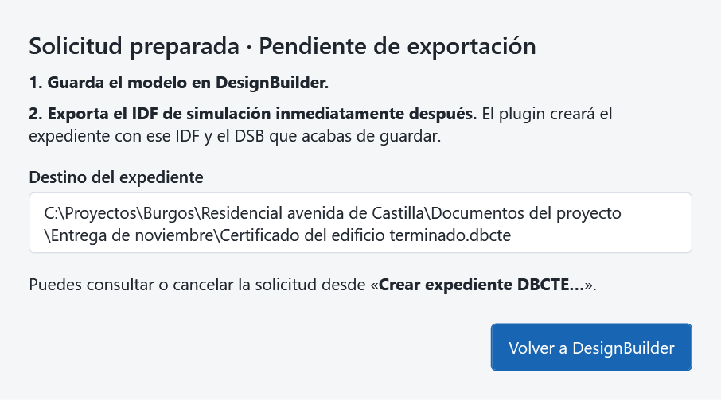
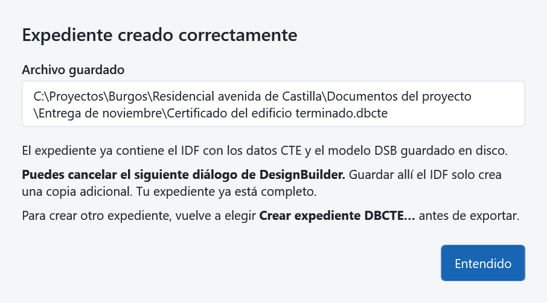

Al elegir el destino del archivo `.dbcte`, aparece **Solicitud preparada · Pendiente de exportación**. Compruebe la ruta bajo **Destino del expediente**. Puede seleccionarla y copiarla. Pulse **Volver a DesignBuilder**, guarde el modelo y exporte inmediatamente después el IDF de simulación. Intro, Esc y el cierre de la ventana también conservan la solicitud. Para consultarla o cancelarla, abra **Crear expediente DBCTE…**.

{width=100%}

Al finalizar la exportación, **Expediente creado correctamente** confirma que el archivo de la ruta indicada bajo **Archivo guardado** ya contiene el IDF con los datos CTE y el DSB guardado. Pulse **Entendido**. Si DesignBuilder le ofrece guardar el IDF por separado, puede cancelar ese diálogo. El expediente ya está completo. Para generar otro, prepare una nueva solicitud desde **Crear expediente DBCTE…**.

{width=100%}
