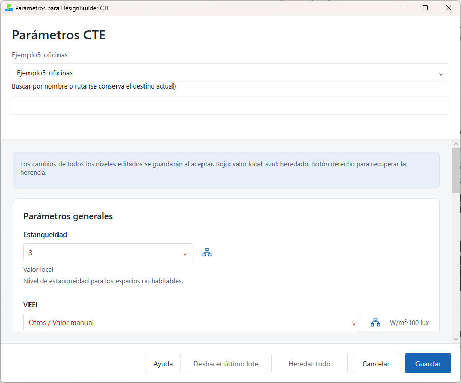

# Empezar con el plugin

El plugin prepara los datos que DesignBuilder CTE necesita del modelo de DesignBuilder. Permite asignar parámetros por niveles, revisar longitudes y transmitancias de puentes térmicos, conservar cálculos Ψ y crear el expediente `.dbcte` que continúa en la aplicación.

Esta guía sigue el mismo recorrido que la guía de la aplicación: objetivo, acciones, resultado esperado y comprobación. Está dirigida a quien prepara el modelo y a quien necesita revisar cómo se obtuvo el expediente.

Los nombres de pestañas y nodos corresponden a la interfaz en español: **Actividad**, **Cerramientos**, **Huecos**, **Iluminación**, **HVAC** y **Sistema HVAC**.

::: {.callout-note title="Cómo utilizar esta guía"}
Las capturas muestran los formularios del plugin y ejemplos de consulta. El caso práctico utiliza una vivienda y la captura de parámetros muestra un edificio de evaluación. Los valores del ejercicio no constituyen una validación técnica del edificio. La exportación completa y la reimportación deben verificarse en cada expediente.
:::

::: {.callout-note title="Comprobar el plugin instalado" icon=false}
DesignBuilder CTE comprueba al iniciar que el plugin y la plantilla coincidan con los de su instalación. Si avisa de una diferencia, cierre DesignBuilder, pulse **Abrir Configuración** y después **Reparar o reinstalar plugin y plantilla**. Vuelva a abrir DesignBuilder para cargar el plugin actualizado. **Ahora no** permite continuar y posponer la reparación.

Consulte [Instalar el plugin y la plantilla](https://ayudacte.ecoeficiente.es/aplicacion/capitulos/02-instalacion.html#instalar-el-plugin-y-la-plantilla).
:::

## Elegir un recorrido

- **Preparar:** siga los capítulos de parámetros y puentes en orden.
- **Revisar:** consulte las asignaciones Ψ y la lista de comprobación del expediente.
- **Resolver:** utilice la tabla de problemas habituales del último capítulo.

## Preparar el ejercicio

1. Abra el DSB de la vivienda de ejemplo.
2. Guarde una copia con otro nombre antes de practicar cambios.
3. Seleccione el **edificio** en el árbol de navegación. El sitio no equivale al edificio.
4. Localice **DesignBuilder CTE** en la barra superior.
5. Revise primero los parámetros; después, los puentes; por último, cree el expediente.

Mantenga el modelo original como referencia. Las cifras de la vivienda sirven para aprender a manejar los controles, no como valores recomendados para otro edificio.

## Mapa de comandos de la versión actual

| Comando | Para qué sirve | Resultado |
|---|---|---|
| Asignar parámetros CTE | Editar parámetros y excepciones en la jerarquía | Datos CTE guardados en el modelo |
| Editar puentes térmicos | Revisar L, Ψ y aportación por tipo de encuentro | Tabla completa de puentes |
| Calculadora de puentes térmicos | Gestionar cálculos y asignarlos a encuentros | Conjunto de cálculos Ψ del edificio |
| Crear expediente DBCTE… | Elegir el destino y preparar la siguiente exportación IDF | Solicitud de creación pendiente |
| Abrir modelo DSB desde DBCTE… | Recuperar el modelo contenido en un expediente | Modelo nuevo en DesignBuilder |

Con un modelo abierto, **Crear expediente DBCTE…** permite elegir el destino. Si ya hay una solicitud pendiente, muestra su ruta y el aviso **Pendiente de exportar el IDF**. **Volver a DesignBuilder**, Escape o cerrar la ventana conservan la solicitud; **Cancelar creación** la retira. Elegir el destino prepara la solicitud: exporte el IDF de simulación para completar el expediente.

## Los tres niveles de guardado

- **Aceptar cálculo / Aplicar:** prepara un cálculo o su asignación dentro del editor que lo contiene.
- **Guardar / Guardar en el modelo:** acepta los cambios del plugin en el modelo abierto.
- **Guardar DSB en DesignBuilder:** conserva el modelo en disco.

Exportar un archivo `.ctepsi` conserva los cálculos elegidos como archivo independiente. No sustituye el guardado del DSB ni crea un expediente de certificación.

## Recorrido recomendado

1. Parámetros generales del edificio y excepciones de zonas/huecos.
2. Pertenencia a la envolvente y marcas de intervención HE.
3. Longitudes de puentes por zona.
4. Valores Ψ, cálculo y asignación cuando proceda.
5. Guardado del DSB, creación del DBCTE y apertura en la aplicación.

[Descargar la guía en PDF](Guia-del-plugin-DesignBuilder-CTE.pdf){.btn .btn-primary}

## Consultar la ayuda {#sec-ayuda}

El menú **DesignBuilder CTE → Ayuda** abre esta guía, incluso sin modelo. Cada ventana del plugin dispone de un botón **Ayuda** que abre el apartado correspondiente en el navegador: parámetros, puentes térmicos, cálculos y sus diálogos de reparto, carga, destinos, ponderación y detalle constructivo.

La ayuda requiere Internet. Si no puede iniciarse el navegador, el aviso muestra la dirección para consultarla manualmente.

{width=100% fig-alt="Parámetros CTE y acceso a la ayuda."}
