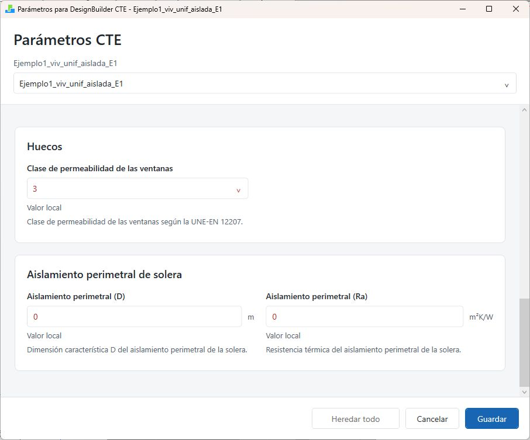

# Asignar parámetros CTE

## Seleccionar el destino

1. Seleccione el edificio y abra **Asignar parámetros CTE**.
2. Lea la cabecera y el selector de nivel; compruebe el objeto de destino.
3. Introduzca los valores comunes en el nivel más alto que los comparta.
4. Descienda a bloque, zona, superficie o hueco para las excepciones.
5. Revise los mensajes de validación y pulse **Guardar**.
6. Guarde también el DSB.

El editor muestra solo los campos disponibles en el nivel seleccionado. La ausencia de un campo en un hueco no significa que el dato se haya borrado del edificio.

{width=90% fig-alt="Edificio: estanqueidad y selector VEEI."}

Para trabajar sobre una superficie o un hueco, seleccione primero ese elemento en DesignBuilder y después abra el editor. El selector mostrado en las capturas permite recorrer edificio, bloques y zonas. La cabecera identifica el destino: compruébela antes de editar.

## Campos y finalidad

| Campo | Cómo utilizarlo | Comprobación |
|---|---|---|
| Estanqueidad | Seleccione el nivel 1 a 5 para espacios no habitables | No confundir con n50 ni con clase de ventana |
| Efectividad sensible equivalente para demanda | Automático o Manual 0–100 %, con herencia edificio/bloque/zona acondicionada | Solo demanda; 0 % desactiva la recuperación ideal |
| VEEI | Revise el límite de eficiencia de iluminación del uso terciario | Unidad W/m² por 100 lux; no equivale a potencia instalada |
| Pertenencia a la envolvente térmica | Interior; Exterior solo para no habitables justificadas | Revise el tipo de zona mostrado en cabecera |
| Intervención en cerramientos opacos | Sin intervención, Intervención directa o Cambio de condiciones | Aplique al elemento realmente afectado |
| Intervención en huecos | Seleccione la marca independientemente de los opacos | Intervenir fachada no implica sustituir ventanas |
| Clase de permeabilidad de las ventanas | Seleccione 1, 2, 3 o 4 conforme a documentación | Use excepciones en los huecos diferentes |
| Aislamiento perimetral (D) | Dimensión característica del aislamiento, en m | Solo edificio; cero si no existe |
| Aislamiento perimetral (Ra) | Resistencia térmica del aislamiento, en m²K/W | Coherencia con la solución de solera |

Los valores iniciales son ayudas de entrada. No acreditan las características de un edificio. Estanqueidad parte del nivel 3, VEEI del valor manual 3, la clase de ventanas de 2 y las marcas HE de **Sin intervención**. `D` y `Ra` parten de cero y la pertenencia a la envolvente es **Interior**. Los valores ya guardados y las excepciones pueden ser distintos: revise lo que muestra cada objeto.

`D` y `Ra` se definen solo en edificio; **Pertenencia a la envolvente térmica**, en zona. La efectividad sensible para demanda se configura en edificio y bloque y, a nivel de zona, solo en las acondicionadas. Defina los demás parámetros en el nivel más alto que comparta el valor y revise sus excepciones.

### Seleccionar VEEI

Abra la lista de usos y elija la descripción que corresponda al espacio. Si requiere un valor específico, seleccione **Otros / Valor manual** y complete la entrada numérica inferior. Revise ambos controles; el texto de la lista identifica el criterio y el número expresa el límite utilizado. En la vivienda del ejemplo el campo sigue visible, pero su aplicación debe revisarse en los espacios terciarios.

{width=90% fig-alt="Clase de ventana y aislamiento perimetral: unidades, valores locales y botones de aceptación."}

### Aislamiento perimetral de solera

Introduzca `D` y `Ra` en el edificio; cero cuando no exista ese aislamiento. Su efecto depende de la solera y de las capas definidas en **Cerramientos**:

- **Solera superficial**, hasta 0,5 m bajo la cota cero: si alguna capa tiene una resistencia de al menos 0,5 m²K/W, se trata como aislamiento continuo. El cálculo utiliza el mayor valor entre la resistencia de esa capa y `Ra`, sin sumarlos; en esta situación `D` no cambia el resultado.
- **Solera superficial sin esa capa:** utiliza `D` y `Ra` para el aislamiento perimetral, o el tratamiento sin aislamiento cuando corresponda.
- **Solera enterrada**, a más de 0,5 m bajo la cota cero: utiliza profundidad, geometría y resistencias de las capas; `D` y `Ra` no intervienen.

DesignBuilder CTE prepara el cerramiento de simulación con la transmitancia calculada sin modificar las capas del DSB. Las tablas tienen límites y sus prolongaciones son aproximaciones del programa. La guía de la aplicación desarrolla los criterios de terreno y los límites que conviene contrastar.

## Herencia: practicar una excepción

1. Establezca la clase de ventana común en el edificio de la copia de trabajo.
2. Seleccione una zona o hueco que deba ser diferente.
3. Cambie únicamente la clase de ventana de ese objeto.
4. Compruebe que se identifica como **Valor local**, en rojo.
5. Pulse con el botón derecho sobre el campo y elija **Heredar del nivel superior** para retirar la excepción.
6. Compruebe **Heredado / predeterminado**, en azul.

**Heredar todo** retira las excepciones aplicables del editor. Antes de usarlo, revise qué datos desea mantener. No edite manualmente las etiquetas de DesignBuilder para simular herencia.

**Guardar** acepta los cambios preparados. **Cancelar** los descarta. Los colores ayudan a localizar el origen; la descripción textual permite distinguirlo sin depender solo del color.

## Tipo de zona y envolvente

Al seleccionar una zona, la cabecera muestra **Acondicionada**, **No acondicionada** o **No habitable**. Es información de solo lectura, determinada por la pertenencia a un grupo de zonas del **Sistema HVAC** y por la casilla **Ocupada** de **Actividad**. Revise el estado efectivo de esa casilla, local o heredado, para el método de ocupación seleccionado.

| En un grupo HVAC | Casilla Ocupada | Tipo de zona |
|---|---|---|
| Sí | Marcada o desmarcada | Acondicionada |
| No | Marcada | No acondicionada |
| No | Desmarcada | No habitable |

La pertenencia al grupo determina **Acondicionada** aunque atienda solo ventilación o tenga calefacción y refrigeración desactivadas. Para revisar sus conexiones, abra **Sistema HVAC**; el tipo de zona no se cambia directamente en el plugin.

1. Seleccione una zona.
2. Lea su tipo.
3. Compruebe Pertenencia a la envolvente térmica.
4. Si el tipo es incorrecto, cierre el editor y revise el grupo en **Sistema HVAC** o la casilla **Ocupada** de **Actividad** en DesignBuilder.
5. Vuelva a abrirlo y confirme el resultado.

Las zonas acondicionadas y no acondicionadas son habitables y deben permanecer en **Interior**. **Exterior** requiere una zona no habitable y una exclusión justificada. Si una zona Exterior pasa a ser habitable por un cambio de grupo u ocupación, seleccione Interior antes de guardar o exportar.

{width=90% fig-alt="Zona E01: tipo No habitable y pertenencia Interior; VEEI aparece heredado."}

**Resultado del ejemplo:** E01 está clasificada como No habitable y conserva Interior. No habitable no implica automáticamente Exterior; son dos conceptos distintos.

## Ajustes que se completan en DesignBuilder CTE {#n50-introducir-modificar-o-retirar}

**n50 adoptado** se introduce en **Datos del Edificio > Características** de la aplicación. **Usar valor de reflectancia de los materiales** se configura en **Datos del modelo**, junto a **Sistemas de sustitución**, que está desactivado inicialmente. Estos ajustes pertenecen al expediente y deben revisarse al crear uno nuevo. Modificarlos exige recalcular en DesignBuilder CTE.

El manual de usuario desarrolla las condiciones de uso en **n50 adoptado**, **Reflectancia de los materiales** y **Sistemas de sustitución**, dentro de **Trabajar con DesignBuilder CTE**.

Al guardar parámetros, el plugin retira atributos que ya no forman parte de su esquema. Los valores vigentes y los datos auxiliares de VEEI y puentes térmicos se conservan. Cancelar no modifica el modelo.

## Recuperación de calor para demanda {#sec-recuperacion-demanda}

La recuperación de calor reduce la demanda de calefacción o refrigeración aprovechando el aire extraído para acondicionar el aire exterior. Para calcular esa demanda, DesignBuilder CTE representa su efecto mediante un porcentaje de **efectividad sensible equivalente** en el sistema ideal de cada zona. Este ajuste no modifica el recuperador del modelo utilizado para calcular el consumo.

El campo está en **Asignar parámetros CTE > Recuperación de calor — avanzado**. Puede elegir:

| Modo | Qué valor utiliza el cálculo de demanda |
|---|---|
| **Automático** — predeterminado | Lo calcula a partir de los datos del recuperador y del caudal de ventilación atendido. |
| **Manual** | Utiliza directamente el porcentaje que introduzca, entre **0 y 100 %**, incluidos decimales. **0 % desactiva la recuperación en demanda para esa zona**. |

### Cómo se obtiene el valor automático

El programa toma el menor de los cuatro rendimientos sensibles del recuperador: calefacción y refrigeración al 75 % y al 100 % del **caudal de aire**. Si el caudal nominal del recuperador es inferior a la ventilación total de las zonas atendidas, reduce ese rendimiento en la misma proporción.

**Ejemplo:** el menor rendimiento es 73 %, el recuperador trata 600 m³/h y las zonas necesitan 1.000 m³/h. La efectividad equivalente es **73 % × 600 / 1.000 = 43,8 %**. Si el recuperador cubre todo el caudal, se utiliza el 73 %. Con caudal nominal **Autosize**, se supone cobertura completa, sin realizar un dimensionado previo.

### Cuándo utilizar Manual

Mantenga Automático salvo que disponga de una justificación técnica para otro valor equivalente. Un **Manual de 60 %** sustituye al 43,8 % del ejemplo: el programa aplica el 60 % sin volver a reducirlo por caudal. Por tanto, el porcentaje introducido debe considerar ya cuánto aire puede tratar el recuperador.

No introduzca directamente un rendimiento estacional que incluya el efecto del bypass: el control del sistema ideal puede contabilizarlo de nuevo. Conserve la justificación del valor elegido.

### Cómo configurarlo y heredarlo

Defina el ajuste común en **edificio** o **bloque**. Las zonas lo heredan y cada **zona acondicionada** puede tener una excepción, aunque comparta recuperador con otras zonas. Modo y porcentaje se heredan juntos.

- Para fijar otro porcentaje, seleccione **Manual** e introdúzcalo.
- Para usar el cálculo automático bajo un edificio o bloque con Manual, seleccione **Automático** en la zona.
- Para eliminar la excepción, pulse con el botón derecho y elija **Heredar del nivel superior**.

{width=90% fig-alt="Zona acondicionada con efectividad manual del 60 por ciento heredada."}

{width=90% fig-alt="Zona con modo Automático local que sustituye el Manual heredado."}

Pulse **Guardar**, guarde el modelo DSB y exporte el expediente. Ábralo en DesignBuilder CTE y pulse **Calcular**. El registro muestra la efectividad aplicada a cada zona.

### Alcance del ajuste

Solo se aplica a zonas acondicionadas con ventilación exterior atendida por un recuperador. No crea recuperación donde no existe ni activa un equipo permanentemente parado. Una excepción manual no cambia la ventilación ni la efectividad automática de las demás zonas: sus caudales siguen formando parte del total atendido.

La equivalencia considera únicamente el calor sensible, no el intercambio de humedad. Es una aproximación: no reproduce en detalle los horarios propios del recuperador, el desescarche ni todos sus controles. Tomar el menor rendimiento no garantiza por sí solo una demanda anual más desfavorable.

## Cámaras sanitarias {#sec-camaras-sanitarias}

**Preparado para la próxima entrega de pruebas; todavía no distribuido.** En una zona no habitable, seleccione **Tipo de espacio no habitable: Cámara sanitaria**. Mantenga **Pertenencia a la envolvente térmica** conforme al límite térmico definido en el proyecto. La selección de cámara no cambia esa pertenencia ni convierte el espacio en habitable.

| Campo | Nivel | Cómo utilizarlo |
|---|---|---|
| Tipo de espacio no habitable | Zona | General o Cámara sanitaria; General es el valor inicial |
| Profundidad de la cámara (m) | Zona | Auto toma el terreno en Z = 0; introduzca la profundidad real en metros si esa referencia no corresponde al proyecto |
| Método U del suelo sanitario | Superficie de suelo | Automático o Justificada |
| U justificada del suelo sanitario | Superficie de suelo | U equivalente positiva en W/(m²·K), solo para Justificada |
| Método de justificación de U sanitaria | Superficie de suelo | Método contrastado utilizado para obtener esa U |
| Referencia documental de U sanitaria | Superficie de suelo | Documento y apartado que justifican el valor |

No es necesario introducir área, altura, perímetro ni resistencia del forjado: se obtienen de la geometría y de las capas del IDF. El cálculo automático admite suelo y techo horizontales, altura uniforme y contorno reconstruible; los casos restantes requieren U justificada.

En **Auto**, un suelo de cámara en Z = −0,50 m tiene profundidad 0,50 m; a cota cero o superior se considera profundidad cero. Se utilizan cotas globales, después de transformar las coordenadas de zona. **Los bloques de componente de tipo terreno por encima de Z = 0 no se reconocen como una elevación del terreno para esta profundidad.** En esos modelos, compruebe y corrija la profundidad en el plugin, vuelva a exportar y calcular, y revise los resultados y justificaciones de los informes HE/HE1. Si la geometría no permite el cálculo automático, utilice U justificada. No basta con dibujar el bloque de terreno para que el informe incorpore esa corrección.

**Estanqueidad** es la fuente de renovación de aire de la cámara. Los niveles 1–5 corresponden a 0; 0,5; 1; 5 y 10 renovaciones por hora. Los niveles 3–5 declaran aberturas o juntas abiertas y permiten seleccionar el procedimiento de cámara ventilada. No añada otro dato de ventilación para esta comprobación ni confunda Estanqueidad con n50 o con la clase de permeabilidad de ventanas.

Con la cámara fuera de la envolvente, el programa comprueba la U del forjado superior. Para una cámara ventilada de altura ≤ 1 m y profundidad ≤ 0,5 m utiliza la tabla 9 del DA DB-HE/1. Si Rf > 3 m²·K/W o B′ < 1 m, no extrapola: solicita U justificada. Las cámaras más altas o más profundas siguen los procedimientos indicados en [el cálculo de cámaras sanitarias](https://ayudacte.ecoeficiente.es/aplicacion/capitulos/07-calculo.html#sec-camaras-sanitarias).

Ejemplo: una cámara de 8 × 8 m y 0,50 m de altura aporta A = 64 m², P = 32 m y B′ = 4 m. Con Estanqueidad 3 se considera 1 renovación/hora. Si el forjado tiene Rf ≈ 4,28, su U requiere un método justificado porque supera el dominio de resistencia de la tabla 9. No reduzca el aislamiento ni altere las capas para forzar un resultado tabulado.

Para **Justificada**, complete valor, método y referencia; no se aceptan los textos iniciales «Sin indicar». Guarde los parámetros y el DSB, vuelva a crear el expediente y calcule en DesignBuilder CTE. El DOCX identifica los valores adoptados por el técnico.

## Marcar una reforma

| Marca | Cuándo corresponde |
|---|---|
| Sin intervención | El elemento no se interviene |
| Intervención directa | Se sustituye, incorpora o modifica sustancialmente; cuenta como superficie renovada |
| Cambio de condiciones | Cambian las condiciones y aumentan las necesidades; no equivale a sustitución ni suma como renovación directa |

1. Defina el criterio común en el nivel adecuado.
2. Marque las excepciones en superficies y huecos.
3. Revise opacos y huecos por separado.
4. Guarde el editor y el DSB y cree de nuevo el expediente.
5. Complete también **Datos del Edificio > Ámbito HE** en DesignBuilder CTE y regenere el informe.

Estas marcas describen la actuación. No cambian por sí mismas materiales, sistemas ni propiedades físicas.
