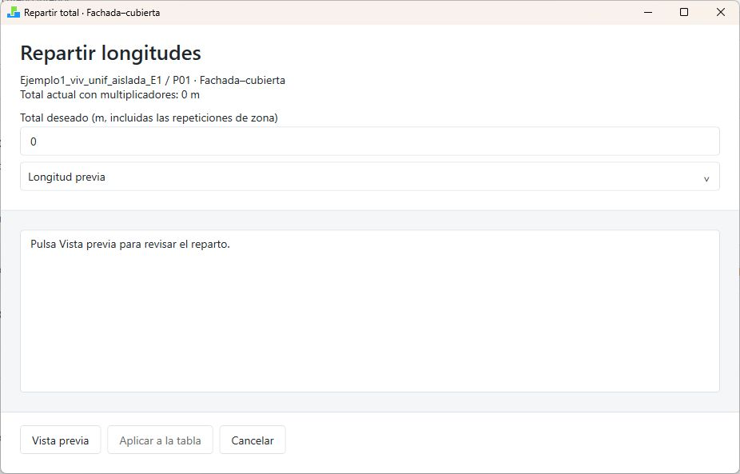

# Editar puentes térmicos

## Leer la tabla

1. Seleccione el edificio y abra **Editar puentes térmicos**.
2. Lea el criterio dimensional de la cabecera.
3. Elija edificio, bloque o zona en el selector.
4. Revise cada tarjeta: longitud L, transmitancia lineal Ψ, origen y contribución.

En zona, **L (m)** es editable por instancia. En bloque y edificio, **L total (m)** es la suma con multiplicadores y se consulta como total. No repita ese total en todas las zonas.

La contribución es **L × Ψ**, en W/K; en un conjunto se suma con multiplicadores. Un Ψ bajo no compensa automáticamente una longitud duplicada. Los Ψ negativos deben conservar su signo cuando estén técnicamente justificados.

{width=100% fig-alt="Bloque P01: parámetros auxiliares, longitud total y Ψ heredado."}



## Tipos de encuentro

| Tipo | Qué revisar |
|---|---|
| Fachada-cubierta | Encuentro superior de la envolvente |
| Fachada-balcón | Vuelo y continuidad del aislamiento |
| Esquina saliente | Encuentros exteriores salientes |
| Esquina entrante | Concavidades; signo y criterio dimensional |
| Fachada-forjado interior | Frente del forjado intermedio |
| Partición interior-fachada/cubierta | Encuentros de particiones con envolvente |
| Fachada-solera/terreno | Encuentro inferior con terreno |
| Pilar-fachada/cubierta | Pilares de envolvente, sin duplicación |
| Jambas | Laterales de huecos |
| Dinteles/capialzados | Parte superior de huecos y cajones compatibles |
| Alféizares | Parte inferior de huecos |
| Fachada-suelo exterior | Suelos expuestos al exterior |
| Otros encuentros | Encuentros que requieren caracterización específica |

Balcón, partición y otros no tienen equivalencia automática con el atlas en esta tabla. Introduzca Ψ con una justificación externa; no seleccione una categoría distinta solo para obtener un número.

Si el editor avisa de que ha adaptado datos antiguos al guardar, revise los valores antes de aceptarlos. Esa adaptación conserva los valores efectivos previos; solo se estiman nuevas longitudes cuando solicita expresamente su carga.

## Cargar longitudes de zonas {#cargar-longitudes-de-zonas}

1. Seleccione el ámbito que desea cargar.
2. Revise **Número de pilares por zona** y **Esquinas entrantes (%)**. Estos campos preparan la siguiente carga; no son longitudes.
3. Pulse **Cargar longitudes de zonas…**.
4. Lea la vista previa, con objeto, valor anterior y propuesto.
5. Revise avisos y zonas afectadas.
6. Pulse **Aplicar a la tabla** si la propuesta corresponde al modelo.
7. Revise las tarjetas y pulse **Guardar** para conservarla.

Cerrar la vista previa sin aplicar evita aceptar la propuesta. Cancelar el editor principal descarta sus cambios preparados.

El número de pilares y el porcentaje de esquinas entrantes parten de cero y pueden heredarse. Las esquinas se reparten según el porcentaje entrante. Los pilares se estiman con el número indicado y la altura derivada de la zona; si no puede estimarse esa altura, el aviso indica que se conserva su longitud anterior. No dé por resueltas las categorías que no se hayan cargado.

{width=100% fig-alt="Vista previa real: avisos del procedimiento y longitudes anteriores y propuestas por zona."}

La vista previa del ejemplo advierte que los frentes de forjado interior toman el 50 % de la longitud nativa por zona. Describe una estimación interior horizontal mediante espesores zonales y planta rectangular equivalente, que no representa todas las particularidades de cada encuentro. Jambas, dinteles y alféizares conservan las medidas nativas. Para muro-muro utiliza una altura interior media derivada de volumen/área, referida a la altura exterior máxima. Lea esos avisos y revise manualmente las singularidades antes de aplicar.

## Importar Ψ de DesignBuilder

1. Seleccione el nivel de destino.
2. Pulse **Importar Ψ de DesignBuilder…**.
3. Compare los valores anteriores y propuestos.
4. Aplique a la tabla y revise el origen local de los campos.
5. Guarde.

La operación sustituye los Ψ compatibles del nivel seleccionado y conserva los restantes. No carga longitudes ni garantiza que los valores importados representen la solución constructiva prevista.

## Repartir una longitud total {#repartir-una-longitud-total}

1. Seleccione edificio o bloque.
2. Pulse **Repartir total…** en el encuentro elegido.
3. Introduzca el total que quiere distribuir, incluidas las repeticiones de zona.
4. Elija **Longitud previa** o **Superficie** como criterio.
5. Pulse **Vista previa**.
6. Revise pesos, multiplicadores, longitudes por instancia y total resultante.
7. Pulse **Aplicar a la tabla** y después **Guardar**.

Cambiar el total o criterio invalida la vista previa: debe calcularla otra vez. Si el reparto muestra un error, corrija sus datos antes de aplicar. El reparto de longitud no modifica Ψ.

{width=100% fig-alt="Reparto de longitudes: total deseado, criterio y vista previa antes de aplicar."}

## Heredar valores

Use el botón derecho en Ψ, número de pilares o porcentaje de esquinas:

- **Heredar del nivel superior:** retira la excepción del objeto.
- **Heredar hasta nivel de bloque:** extiende la recuperación hasta los bloques afectados.
- **Heredar hasta nivel de zona:** alcanza también las zonas de esa rama.

Desde edificio se conserva el valor del edificio y se retiran las excepciones inferiores del parámetro. Desde bloque se recupera primero el valor superior. Las longitudes de zona no se heredan mediante estas acciones.

Azul identifica un valor heredado o predeterminado; rojo, un valor local. Después de recuperar la herencia, compruebe el valor efectivo y guarde el editor y el DSB.

## Calcular o editar Ψ

**Calcular Ψ…** abre el conjunto de cálculos compatibles. **Editar cálculo…** permite revisar el cálculo asociado. Aplicar Ψ no modifica L. Revise los destinos y conserve el guardado final del editor de puentes.

Si aparece **Hay una revisión más reciente**, el cálculo se ha editado pero la asignación conserva su revisión anterior. Revise y reasigne conscientemente; no presuponga una actualización automática.

## Revisar antes de exportar

DesignBuilder CTE utiliza las longitudes y los valores Ψ exportados por el plugin; no realiza una segunda medición geométrica de las longitudes, tampoco en los expedientes antiguos compatibles. Revise aquí cualquier longitud ausente o incorrecta. La carga de longitudes es una operación explícita del editor: guarde sus valores definitivos antes de crear el expediente.

Revise las trece categorías y los encuentros que no hayan recibido longitud en la carga. Use el mismo criterio dimensional para L y Ψ, compruebe los multiplicadores y evite duplicar encuentros. Guarde el editor y el DSB; después de modificar puentes, cree de nuevo el expediente y recalcule antes de documentar.

En terciario, el edificio de referencia conserva las longitudes y aplica sus Ψ de referencia. Para balcón, partición y otros utiliza Ψ = 0 únicamente en ese edificio de referencia; el edificio objeto conserva los valores introducidos.
