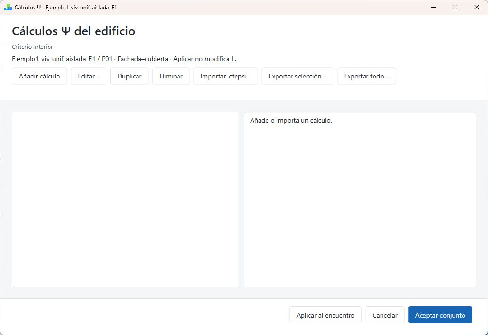
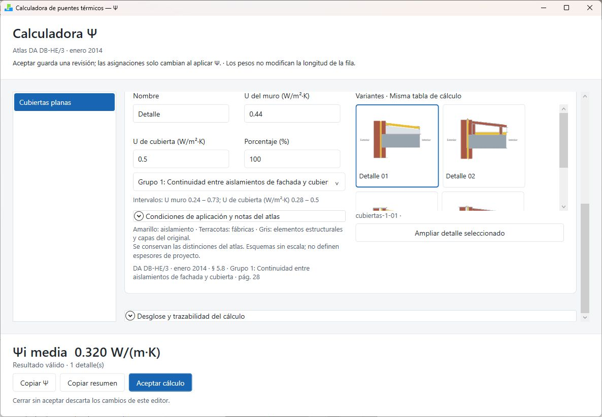
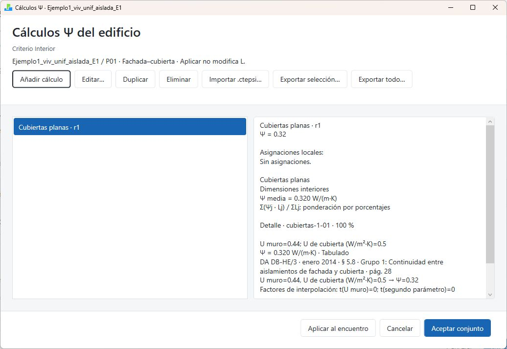

# Calculadora y conjunto de cálculos Ψ

## Organizar cálculos del edificio

Abra **Calculadora de puentes térmicos** desde el menú. El conjunto permite reutilizar un cálculo en varios encuentros compatibles, conservando sus revisiones y asignaciones.

| Acción | Efecto |
|---|---|
| Añadir cálculo | Abre un cálculo nuevo para completar |
| Editar… | Prepara una nueva revisión del cálculo seleccionado |
| Duplicar | Crea una copia independiente para otra solución |
| Eliminar | Retira un cálculo sin asignaciones activas, previa confirmación |
| Importar .ctepsi… | Añade cálculos del archivo, sin asignarlos a encuentros |
| Exportar selección… | Guarda los cálculos seleccionados en un archivo |
| Exportar todo… | Guarda el conjunto como archivo reutilizable |
| Asignar Ψ… | Permite elegir los destinos compatibles |
| Guardar en el modelo | Conserva conjunto y asignaciones en el modelo abierto |
| Cancelar | Descarta lo preparado en esta ventana |

Editar un cálculo no modifica automáticamente sus asignaciones. Un cálculo con asignaciones activas no se puede eliminar: primero revise y sustituya sus destinos.

{width=100% fig-alt="Conjunto abierto desde un encuentro: los botones inferiores son Aplicar al encuentro y Aceptar conjunto."}

## Crear un cálculo paso a paso

1. Pulse **Añadir cálculo**.
2. Escriba un nombre que identifique la solución constructiva.
3. Seleccione la **Categoría** correspondiente al encuentro.
4. Compruebe el criterio de dimensiones interiores Ψi o exteriores Ψe. Cuando procede del modelo, está fijado por ese contexto.
5. Elija ponderación por porcentajes o por longitudes.
6. Seleccione el grupo y el detalle constructivo del atlas.
7. Introduzca U del muro y el parámetro adicional que solicite el grupo.
8. Complete el peso del detalle.
9. Revise las condiciones de aplicación, el resultado y la trazabilidad.
10. Pulse **Aceptar cálculo**.

Cambiar de categoría sustituye los detalles del cálculo y requiere confirmar. Compruebe la categoría antes de introducir varios detalles.

{width=100% fig-alt="Calculadora real: categoría, criterio dimensional, ponderación y resultado."}

**Ejemplo reproducible de manejo:** desde Fachada-cubierta, añada un cálculo de Cubiertas planas, grupo 1 (continuidad entre aislamientos de fachada y cubierta), Detalle 01. Con U del muro = 0,44 W/m²K, U de cubierta = 0,50 W/m²K, criterio interior y un detalle al 100 %, la pantalla muestra Ψi = 0,320 W/(m·K), estado Tabulado. Es una demostración del atlas; no demuestra que ese detalle represente la cubierta de esta vivienda.

## Detalles y ponderación

Un cálculo puede combinar soluciones de una misma categoría. **Añadir detalle** incorpora una fila; **Duplicar detalle** copia la seleccionada; **Eliminar detalle** retira el detalle elegido. Revise los pesos después de cada operación.

- **Por porcentajes:** distribuya la participación de cada solución hasta completar el conjunto.
- **Por longitudes (m):** introduzca la longitud representada por cada solución.
- Al convertir porcentajes a longitudes, se solicita la longitud total para transformar los pesos.

Ejemplo didáctico: dos soluciones con Ψ de 0,30 y 0,50 W/(m·K), ponderadas al 60 % y 40 %, dan 0,38 W/(m·K). Es un ejemplo aritmético, no un valor recomendado del atlas.

Los pesos sirven para obtener Ψ medio. **No sustituyen la longitud L de la tabla de puentes.** Tras aplicar Ψ, compruebe también L por separado.

## Opciones del detalle

| Control | Uso |
|---|---|
| Nombre | Identifica el detalle dentro del cálculo |
| U del muro | Transmitancia térmica que requiere la solución elegida |
| Parámetro secundario | Introduzca la magnitud y unidad que indique ese grupo |
| Porcentaje o longitud | Peso del detalle en la media |
| Miniaturas del atlas | Seleccionan la variante constructiva |
| Ampliar detalle seleccionado | Abre una vista mayor del dibujo |
| Condiciones de aplicación y notas del atlas | Explica restricciones de uso de la solución |
| Permitir extrapolación de U | Autoriza extrapolar U; no extrapola dimensiones geométricas |
| Desglose y trazabilidad del cálculo | Permite revisar cómo se obtuvo el resultado |
| Copiar Ψ | Copia el resultado numérico disponible |
| Copiar resumen | Copia el cálculo explicado para su revisión |

Un dibujo parecido no demuestra que se cumplan sus condiciones. Revise posición del aislamiento, dimensiones y parámetros exigidos. Si aparece un error o no hay resultado, corríjalo antes de aceptar.

{width=100% fig-alt="Detalle constructivo, intervalos de entrada, variantes y condiciones del atlas."}

## Asignar el resultado

1. Seleccione el cálculo del conjunto.
2. Pulse **Asignar Ψ…**.
3. Revise cada destino: objeto, encuentro, valor anterior, nuevo valor y niveles que lo heredarán.
4. Marque solo los destinos que comparten la solución.
5. Use **Seleccionar todos** únicamente si todos corresponden al mismo criterio; **Deseleccionar todos** permite rehacer la selección.
6. Pulse **Aplicar a los destinos seleccionados**.
7. Revise las asignaciones locales e inferiores heredadas.
8. Pulse **Guardar en el modelo** y guarde el DSB.

Las excepciones locales inferiores se conservan salvo que se actúe sobre ellas. Si se accede desde una fila de puentes, la acción se denomina **Aplicar al encuentro** y restringe el destino al contexto seleccionado. En ese caso, pulse después **Aceptar conjunto**, complete **Guardar** en el editor de puentes y guarde el DSB. Aplicar Ψ no modifica la longitud L.

{width=100% fig-alt="Un cálculo aceptado aparece como revisión r1, todavía sin asignaciones."}

{width=100% fig-alt="Antes de aplicar: destino, cambio de 0,23 a 0,32 y nivel que heredará el valor."}

## Revisar una modificación

1. Edite el cálculo y acepte una nueva revisión.
2. Consulte el panel de asignaciones.
3. Localice las asignaciones que conservan revisiones anteriores.
4. Asigne la nueva revisión a los destinos que deban actualizarse.
5. Revise L × Ψ, guarde y exporte de nuevo.

Importar un `.ctepsi` incorpora cálculos, no sus destinos del modelo anterior. El criterio dimensional se adapta al del modelo receptor y debe revisarse antes de asignar.
