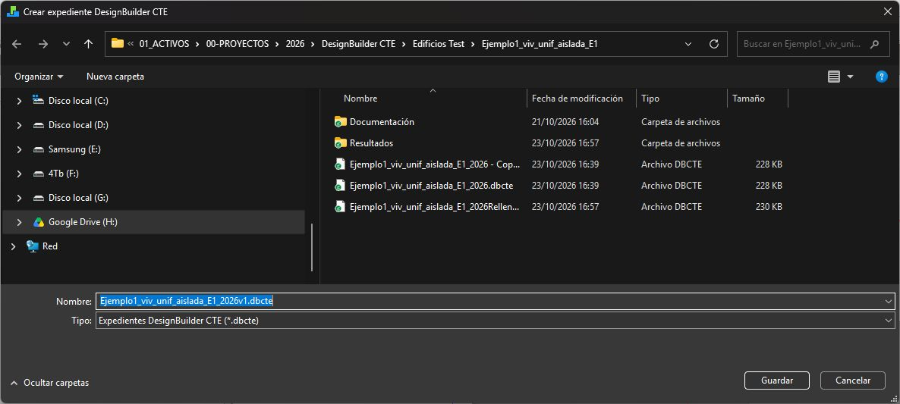

# Crear, recuperar y revisar el expediente

## Comprobaciones previas

1. Guarde el DSB de trabajo.
2. Seleccione el edificio correcto.
3. Revise HVAC detallado, terreno estándar, ventilación natural programada, volumen interior y área de suelo interior.
4. Compruebe clasificación de zonas y pertenencia a la envolvente.
5. Revise parámetros, longitudes, Ψ y excepciones.
6. Prepare una carpeta de salida con permiso de escritura.

Compruebe estas opciones en sus niveles correspondientes:

| Opción | Valor requerido | Dónde revisarla |
|---|---|---|
| Nivel de datos HVAC | HVAC detallado | Edificio |
| Modelado del terreno | 1-Estándar | Sitio |
| Ventilación natural | Programada | Opciones del modelo |
| Cálculo de volumen de zona | 1-Interior | Edificio |
| Cálculo de área de suelo | 1-Interior | Edificio |
| Ámbito de simulación | Edificio completo | Opciones del modelo |

El plugin comprueba las cinco primeras opciones; la selección del edificio completo debe comprobarla el usuario. La ventilación natural de origen se elimina al preparar el cálculo normativo; mantener Programada es un requisito de compatibilidad. La ventilación mecánica se define mediante HVAC detallado y sus conexiones en **Sistema HVAC**.

Las zonas hijas agrupadas no aparecen como zonas independientes en el expediente; se representan por su zona padre. Los cerramientos y huecos de las hijas siguen disponibles en el modelo.

## Crear un DBCTE

1. Abra **DesignBuilder CTE > Crear expediente DBCTE…** y elija el nombre y destino del `.dbcte`. El aviso confirma que la solicitud está preparada y le recuerda guardar el modelo.
2. **Guarde el DSB en DesignBuilder inmediatamente antes de exportar**. Inicie la exportación del IDF de EnergyPlus para **Simulación**.
3. Compruebe la ruta del DSB en el aviso. Si acaba de guardarlo, pulse **Ya he guardado, continuar**. Si aún tiene cambios sin guardar, pulse **Cancelar exportación**, guarde y vuelva a exportar. La solicitud conserva el destino. Escape o cerrar el aviso también conservan la solicitud.
4. Compruebe **Expediente creado correctamente** y la ruta indicada. El `.dbcte` ya contiene el DSB guardado y el IDF generado por DesignBuilder con los datos CTE.
5. En el siguiente diálogo de DesignBuilder, puede pulsar **Cancelar**. Ese diálogo solo sirve para guardar otra copia del IDF en una ubicación que usted elija. El expediente ya está creado.
6. Abra el `.dbcte` en DesignBuilder CTE y compruebe el edificio y el estado del expediente.

El plugin incorpora el DSB tal como se guardó en disco. Guarde antes de exportar para que los cambios de la sesión queden incluidos también en ese modelo.

Cada solicitud genera un solo expediente. Para volver a generarlo, prepare una nueva solicitud con **Crear expediente DBCTE** antes de exportar el IDF de simulación. Puede elegir el mismo destino si desea actualizarlo.

{width=100% fig-alt="Selección real de nombre y destino para preparar el expediente DBCTE."}

**Comprobación final:** abra el archivo generado en la aplicación, compruebe el edificio y revise su estado. La captura muestra el inicio del procedimiento; no acredita una exportación terminada.

### Abrir el expediente creado desde Windows {#abrir-el-expediente-creado-desde-windows}

Cuando se confirme la creación, puede abrir el `.dbcte` con doble clic desde el Explorador. Para recuperar el DSB y abrirlo en DesignBuilder, utilice **Abrir modelo DSB desde DBCTE…**, explicado más abajo.

Si DesignBuilder CTE ya tiene otro proyecto abierto, ofrece **Guardar**, **Descartar** o **Cancelar**. Cancelar el guardado o un fallo al guardar impide cambiar de proyecto. Si el mismo expediente ya está abierto, solo se activa su ventana. Si hay una operación en curso, espere a que termine y repita la apertura.

Si Windows no lo abre en DesignBuilder CTE, use **Abrir con > Elegir otra aplicación** y selecciónela como aplicación habitual para `.dbcte`. Conserve el expediente exportado y compruebe su estado después de abrirlo; el icono no acredita que el contenido sea válido.

## Cancelar una solicitud pendiente

Abra **Crear expediente DBCTE…** y pulse **Cancelar creación**. La siguiente exportación ya no completará esa solicitud. Puede volver a **Crear expediente DBCTE…** para elegir otro destino.

**Cancelar creación** retira la solicitud. **Cancelar exportación**, en el aviso previo a generar el IDF, interrumpe ese intento y mantiene la solicitud pendiente. Los expedientes ya creados se conservan.

## Recuperar un modelo desde DBCTE

1. Guarde el trabajo que tenga abierto en DesignBuilder.
2. Seleccione **DesignBuilder CTE > Abrir modelo DSB desde DBCTE…**. El comando está disponible también sin un modelo abierto.
3. Elija el expediente y el nombre y destino del DSB que desea extraer.
4. Compruebe que DesignBuilder termina de abrirlo. Si cancela la apertura o surge un error, puede abrir manualmente el DSB extraído.

El archivo extraído es el DSB guardado que se incorporó al expediente. La extracción conserva el `.dbcte` de origen.

## Lista de comprobación del técnico

- [ ] El DSB y DBCTE corresponden al mismo edificio y revisión.
- [ ] El objeto seleccionado en cada editor es el previsto.
- [ ] Los valores por defecto se han revisado.
- [ ] Se conocen las excepciones locales y el origen de los valores heredados.
- [ ] Las zonas habitables pertenecen a Interior.
- [ ] Las exclusiones de zonas no habitables están justificadas.
- [ ] Las marcas de intervención distinguen opacos y huecos.
- [ ] Las longitudes están por instancia de zona y los totales incluyen los multiplicadores una sola vez.
- [ ] Los Ψ corresponden al mismo criterio dimensional que las longitudes.
- [ ] Los cálculos usados están asignados a los destinos correctos y con la revisión prevista.
- [ ] Se han revisado L × Ψ y los encuentros sin cálculo automático.
- [ ] El modelo se ha guardado y el expediente se abre correctamente.

## Problemas habituales

Si falta el aviso de creación, pulse **Crear expediente DBCTE** para comprobar el estado: si muestra una solicitud pendiente, revise el destino y complete la exportación IDF de **Simulación**; si abre el selector de destino, prepare una nueva solicitud. Compruebe la fecha del archivo antes de utilizarlo. Si la primera exportación de una solicitud sigue sin generar el expediente, conserve la hora del intento y cualquier mensaje de error para comunicar la incidencia.

| Situación | Qué revisar |
|---|---|
| No aparecen comandos del plugin | Modelo cargado, instalación y selección del edificio |
| No aparece un parámetro | Nivel seleccionado y alcance del campo |
| No permite guardar | Mensajes de validación y compatibilidad de zona/envolvente |
| Un cambio superior no afecta a una zona | Excepción local o intermedia |
| Longitud total inesperada | Longitudes por zona, multiplicadores y ámbito seleccionado |
| Ψ nuevo no llega al encuentro | Aceptación del cálculo, asignación y guardado final |
| Hay revisión más reciente | Revisar y reasignar la nueva revisión |
| No se puede eliminar un cálculo | Tiene asignaciones activas |
| No se crea el DBCTE tras elegir nombre | Pulse Crear expediente DBCTE para comprobar la solicitud; revise destino, exportación IDF de Simulación y validaciones |
| Se canceló el aviso previo a la exportación | Guarde el DSB y vuelva a exportar el IDF. La solicitud sigue pendiente |
| Se canceló el diálogo final de guardar IDF | Si ya vio **Expediente creado correctamente**, abra el `.dbcte` en la ruta indicada |
| n50 no coincide con el informe | Comprobar n50 adoptado en Datos del Edificio y el último cálculo |
| n50 no puede repartir el caudal | Comprobar que existen opacos exteriores o fugas iniciales en huecos y puertas |

## Continuar en DesignBuilder CTE

1. Abra el `.dbcte` y compruebe edificio y estado.
2. Complete **Datos del Edificio**, **Datos del Certificador**, **Ámbito HE** y **Datos del modelo**.
3. Pulse **Calcular**. Tras modificar puentes en el modelo, utilice el expediente de la nueva exportación y recalcule. n50 se modifica directamente en Datos del Edificio y también exige recalcular.
4. Genere HE/HE1 cuando correspondan; compruebe el n50 adoptado indicado en el informe.
5. Genere el XML base, complételo en XML Medidas y genere el PDF desde el XML final.
6. Pulse **Guardar** para incorporar la certificación; elija otro nombre o carpeta si necesita una copia.

Los DOCX HE/HE1 se conservan aparte, en **Documentación**. **Resultados** tampoco está dentro del `.dbcte`. La guía de la aplicación explica los formularios, la calculadora de ACS y la conservación de estos archivos.
