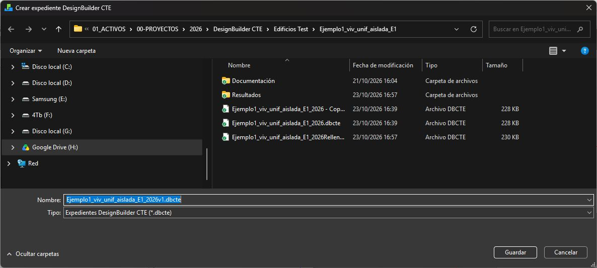

# Crear, recuperar y revisar el expediente

## Comprobaciones previas

1. Guarde el DSB de trabajo.
2. Seleccione el edificio correcto.
3. Revise HVAC detallado, terreno estándar, ventilación natural programada, volumen interior y área de suelo interior.
4. Compruebe clasificación de zonas y pertenencia a la envolvente.
5. Revise parámetros, longitudes, Ψ y excepciones.
6. En **Opciones del programa > Archivos XML de DesignBuilder**, seleccione **1-Ninguno** para **Incluir datos de bibliotecas en archivo XML de DesignBuilder**.
7. Prepare una carpeta de salida con permiso de escritura.

Si la comprobación de bibliotecas falla o sigue activada su inclusión, el plugin informa y no prepara el expediente. Corrija la opción antes de volver a intentarlo.

Compruebe estas opciones en sus niveles correspondientes:

| Opción | Valor requerido | Dónde revisarla |
|---|---|---|
| Nivel de datos HVAC | HVAC detallado | Edificio |
| Modelado del terreno | 1-Estándar | Sitio |
| Ventilación natural | Programada | Opciones del modelo |
| Cálculo de volumen de zona | 1-Interior | Edificio |
| Cálculo de área de suelo | 1-Interior | Edificio |
| Ámbito de simulación | Edificio completo | Opciones del modelo |

El plugin comprueba las cinco primeras opciones; la selección del edificio completo debe comprobarla el usuario. La ventilación natural de origen se elimina al preparar el cálculo normativo; mantener Programada es un requisito de compatibilidad. La ventilación mecánica se define mediante HVAC detallado y sus conexiones en **Sistema HVAC**.

## Crear un DBCTE

1. Abra **DesignBuilder CTE > Crear expediente DBCTE**.
2. Elija nombre y destino del `.dbcte`.
3. Lea el aviso: la **siguiente exportación IDF** incorporará los datos CTE y el modelo XML.
4. Ejecute la exportación de archivo IDF de EnergyPlus para simulación desde DesignBuilder.
5. Atienda los avisos de validación; corrija el modelo si alguno impide continuar.
6. Espere la confirmación de creación correcta.
7. Abra el `.dbcte` en DesignBuilder CTE y compruebe su estado.

El nombre elegido no acredita que se haya creado el archivo. La exportación debe finalizar correctamente. Conserve la correspondencia entre DSB y DBCTE y utilice nombres de revisión claros.

{width=100% fig-alt="Selección real de nombre y destino para preparar el expediente DBCTE."}

**Comprobación final:** abra el archivo generado en la aplicación, compruebe el edificio y revise su estado. La captura muestra el inicio del procedimiento; no acredita una exportación terminada.

### Abrir el expediente creado desde Windows

**Próxima actualización, pendiente de distribución y de validación del instalador:** una vez completada la exportación, podrá abrir el `.dbcte` con doble clic desde el Explorador. El archivo mostrará el icono de DesignBuilder CTE y se abrirá en la aplicación de expedientes. Para recuperar el modelo en DesignBuilder, siga usando **Importar modelo desde DBCTE**, explicado más abajo.

Si DesignBuilder CTE ya tiene otro proyecto abierto, ofrecerá **Guardar**, **Descartar** o **Cancelar**. Cancelar el guardado o un fallo al guardar impide cambiar de proyecto. Si el mismo expediente ya está abierto, solo se activa su ventana. Si hay una operación en curso, espere a que termine y repita la apertura.

Si Windows no lo abre en DesignBuilder CTE, use **Abrir con > Elegir otra aplicación** y selecciónela como aplicación habitual para `.dbcte`. Conserve el expediente exportado y compruebe su estado después de abrirlo; el icono no acredita que el contenido sea válido.

## Cancelar una solicitud pendiente

Tras elegir destino, el menú ofrece **Cancelar creación del expediente**. Úselo si no quiere que la siguiente exportación complete esa solicitud. Después, vuelva a iniciar **Crear expediente DBCTE** para preparar otro destino.

Cancelar la solicitud no borra un expediente previamente creado.

## Recuperar un modelo desde DBCTE

1. Guarde cualquier trabajo actual en DesignBuilder.
2. Seleccione **Importar modelo desde DBCTE**.
3. Elija el expediente.
4. Lea la confirmación y acepte la creación del modelo si es el archivo previsto.
5. Guarde el nuevo DSB con otro nombre.
6. Revise cerramientos, bibliotecas, sistemas y parámetros antes de editar.

Esta operación recupera el modelo incluido en el expediente. No recupera resultados de simulación ni sustituye la revisión técnica de los datos. El expediente original no se modifica.

## Lista de comprobación del técnico

- [ ] El DSB y DBCTE corresponden al mismo edificio y revisión.
- [ ] El objeto seleccionado en cada editor es el previsto.
- [ ] Los valores por defecto se han revisado.
- [ ] Se conocen las excepciones locales y el origen de los valores heredados.
- [ ] Las zonas habitables pertenecen a Interior.
- [ ] Las exclusiones de zonas no habitables están justificadas.
- [ ] Las marcas de intervención distinguen opacos y huecos.
- [ ] Las longitudes están por instancia de zona y los totales incluyen los multiplicadores una sola vez.
- [ ] Los Ψ corresponden al mismo criterio dimensional que las longitudes.
- [ ] Los cálculos usados están asignados a los destinos correctos y con la revisión prevista.
- [ ] Se han revisado L × Ψ y los encuentros sin cálculo automático.
- [ ] El modelo se ha guardado y el expediente se abre correctamente.

## Problemas habituales

| Situación | Qué revisar |
|---|---|
| No aparecen comandos del plugin | Modelo cargado, instalación y selección del edificio |
| No aparece un parámetro | Nivel seleccionado y alcance del campo |
| No permite guardar | Mensajes de validación y compatibilidad de zona/envolvente |
| Un cambio superior no afecta a una zona | Excepción local o intermedia |
| Longitud total inesperada | Longitudes por zona, multiplicadores y ámbito seleccionado |
| Ψ nuevo no llega al encuentro | Aceptación del cálculo, asignación y guardado final |
| Hay revisión más reciente | Revisar y reasignar la nueva revisión |
| No se puede eliminar un cálculo | Tiene asignaciones activas |
| No se crea el DBCTE tras elegir nombre | Falta exportación IDF completa o hay validaciones pendientes |
| Se rechaza la inclusión de bibliotecas | Configurar XML con 1-Ninguno y repetir la solicitud |
| n50 no coincide con el informe | Comprobar n50 adoptado en Datos del Edificio y el último cálculo |
| n50 no puede repartir el caudal | Comprobar que existen opacos exteriores o fugas iniciales en huecos y puertas |

## Continuar en DesignBuilder CTE

1. Abra el `.dbcte` y compruebe edificio y estado.
2. Complete **Datos del Edificio**, **Datos del Certificador**, **Ámbito HE** y **Datos del modelo**.
3. Pulse **Calcular**. Tras modificar puentes en el modelo, utilice el expediente de la nueva exportación y recalcule. n50 se modifica directamente en Datos del Edificio y también exige recalcular.
4. Genere HE/HE1 cuando correspondan; compruebe el n50 adoptado indicado en el informe.
5. Genere el XML base, complételo en XML Medidas y genere el PDF desde el XML final.
6. Pulse **Guardar** para incorporar la certificación; elija otro nombre o carpeta si necesita una copia.

Los DOCX HE/HE1 se conservan aparte, en **Documentación**. **Resultados** tampoco está dentro del `.dbcte`. La guía de la aplicación explica los formularios, la calculadora de ACS y la conservación de estos archivos.
