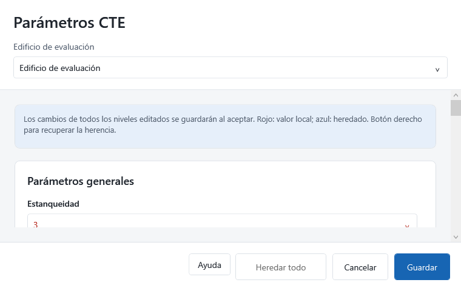

# Empezar con el plugin

El plugin prepara los datos que DesignBuilder CTE necesita del modelo de DesignBuilder. Permite asignar parámetros por niveles, revisar longitudes y transmitancias de puentes térmicos, conservar cálculos Ψ y crear el expediente `.dbcte` que continúa en la aplicación.

Esta guía sigue el mismo recorrido que la guía de la aplicación: objetivo, acciones, resultado esperado y comprobación. Está dirigida a quien prepara el modelo y a quien necesita revisar cómo se obtuvo el expediente.

Revisión de contenido: **27 de octubre de 2026**. Incluye la configuración avanzada de recuperación sensible para demanda, con cálculo automático o porcentaje manual heredable. Los nombres de pestañas y nodos corresponden a la interfaz en español: **Actividad**, **Cerramientos**, **Huecos**, **Iluminación**, **HVAC** y **Sistema HVAC**.

::: {.callout-note title="Cómo utilizar esta guía"}
Las capturas muestran los formularios reales del plugin y ejemplos de consulta. El caso práctico utiliza una vivienda y la captura de parámetros muestra un edificio de evaluación. Los valores del ejercicio no constituyen una validación técnica del edificio. La exportación completa y la reimportación deben verificarse en cada expediente.
:::

## Elegir un recorrido

- **Preparar:** siga los capítulos de parámetros y puentes en orden.
- **Revisar:** consulte las asignaciones Ψ y la lista de comprobación del expediente.
- **Resolver:** utilice la tabla de problemas habituales del último capítulo.

## Preparar el ejercicio

1. Abra el DSB de la vivienda de ejemplo.
2. Guarde una copia con otro nombre antes de practicar cambios.
3. Seleccione el **edificio** en el árbol de navegación. El sitio no equivale al edificio.
4. Localice **DesignBuilder CTE** en la barra superior.
5. Revise primero los parámetros; después, los puentes; por último, cree el expediente.

Mantenga el modelo original como referencia. Las cifras de la vivienda sirven para aprender a manejar los controles, no como valores recomendados para otro edificio.

## Mapa de comandos de la versión actual

{width=40% fig-alt="Menú real del plugin con el modelo cargado."}

| Comando | Para qué sirve | Resultado |
|---|---|---|
| Asignar parámetros CTE | Editar parámetros y excepciones en la jerarquía | Datos CTE guardados en el modelo |
| Editar puentes térmicos | Revisar L, Ψ y aportación por tipo de encuentro | Tabla completa de puentes |
| Calculadora de puentes térmicos | Gestionar cálculos y asignarlos a encuentros | Conjunto de cálculos Ψ del edificio |
| Crear expediente DBCTE | Elegir el destino y preparar la siguiente exportación IDF | Solicitud de creación pendiente |
| Cancelar creación del expediente | Retirar la solicitud pendiente | La siguiente exportación ya no completa esa solicitud |
| Importar modelo desde DBCTE | Recuperar el modelo contenido en un expediente | Modelo nuevo en DesignBuilder |

**Crear expediente** y **Cancelar creación** corresponden a estados alternativos. Elegir un destino no significa que el expediente ya esté creado: falta completar la exportación IDF.

## Los tres niveles de guardado

- **Aceptar cálculo / Aplicar:** prepara un cálculo o su asignación dentro del editor que lo contiene.
- **Guardar / Guardar en el modelo:** acepta los cambios del plugin en el modelo abierto.
- **Guardar DSB en DesignBuilder:** conserva el modelo en disco.

Exportar un archivo `.ctepsi` conserva los cálculos elegidos como archivo independiente. No sustituye el guardado del DSB ni crea un expediente de certificación.

## Recorrido recomendado

1. Parámetros generales del edificio y excepciones de zonas/huecos.
2. Pertenencia a la envolvente y marcas de intervención HE.
3. Longitudes de puentes por zona.
4. Valores Ψ, cálculo y asignación cuando proceda.
5. Revisión de L × Ψ y de los multiplicadores.
6. Guardado del DSB, creación del DBCTE y apertura en la aplicación.

[Descargar la guía en PDF](Guia-del-plugin-DesignBuilder-CTE.pdf){.btn .btn-primary}

## Consultar la ayuda {#sec-ayuda}

::: {.callout-note}
La actualización de pruebas del 27 de octubre de 2026 incorpora los botones de ayuda. Si todavía no aparecen, consulte <https://ayudacte.ecoeficiente.es/plugin/>.
:::

El menú **DesignBuilder CTE → Ayuda** abre esta guía, incluso sin modelo. Cada ventana del plugin dispone de un botón **Ayuda** que abre el apartado correspondiente en el navegador: parámetros, puentes térmicos, cálculos y sus diálogos de reparto, carga, destinos, ponderación y detalle constructivo.

Consultar la ayuda no acepta el diálogo, guarda el modelo ni aplica cálculos. El plugin no asigna la tecla F1; el acceso F1 corresponde a la aplicación independiente DesignBuilder CTE. Los selectores de archivos de Windows conservan sus controles habituales.

La ayuda requiere Internet. Si no puede iniciarse el navegador, el aviso muestra la dirección para consultarla manualmente.

{fig-alt="Ventana de parámetros con el botón Ayuda junto a las acciones inferiores."}

::: {.callout-note title="Candidata 1.0.0-rc.1 — pruebas controladas"}
Edición preparada para el grupo de pruebas; todavía no publicada. Use el paquete RC1 entregado por el desarrollador, compatible con EnergyPlus 23.1.0.002. Conserve una copia de sus expedientes. La validación física de ventiladores HPWH compartidos queda fuera del alcance acreditado. Compruebe exportación, apertura, cálculo, documentos, guardado y reapertura; comunique incidencias indicando la versión completa y el diagnóstico.
:::
